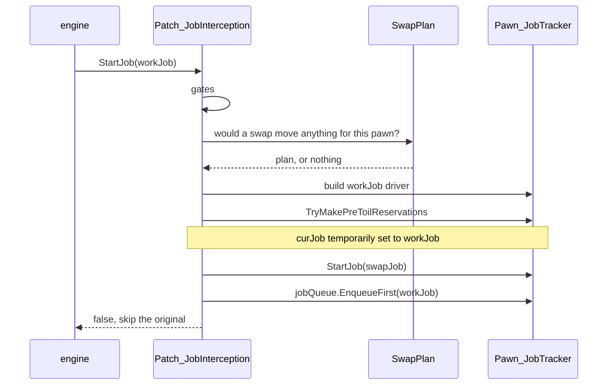
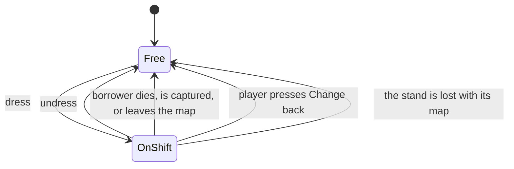

# Design

What this mod interfaces with inside RimWorld, and why each interface took the
shape it did. For build and debug, see [DEVELOPMENT.md](DEVELOPMENT.md).

Engine claims were checked against the decompiled game assembly, version
**1.6.4871**. References like `Pawn_JobTracker.cs:338` point into that
decompilation. Line numbers drift across game versions; method names drift much
more slowly.

No RimWorld modding experience assumed. The primer below covers everything the
rest of the document uses.

## What it does

A vanilla outfit stand placed in a work room dresses colonists for that room's
work. When a colonist takes an **automatic** job whose work type matches the
stand's and whose target is in the stand's room, they change into the stand's
outfit, do the work, and change back when their next job takes them elsewhere.

The mod ships no art and no apparel. It adds behaviour to an existing vanilla
building.

## Constraints

| Constraint | Consequence |
|---|---|
| Automatic work only | A player-forced job is a direct order. Sending the pawn to a wardrobe first makes orders feel broken. Applies in both directions. |
| The room is the boundary | Ties the uniform to where the work is, so a pawn is never far from their civvies in a crisis. An unbounded "always wear X for work Y" mode reintroduces that distance and was rejected. |
| Zero new art | Ownership is patched onto the vanilla def rather than shipped as a new building. Icons come from vanilla's UI atlas. |
| Fail open | This patches the method that starts every job for every pawn. An unhandled exception there is a bricked colony. Every hook catches, logs, and lets vanilla proceed. Interception also counts its throws, and at `FaultLimit` (three) in one game takes itself out of service and tells the player, until a save is loaded or a game started. The `Enabled` tweak is a separate, standing switch that a load leaves alone. Neither gates what protects a pawn already in uniform, nor the Change back button. |

## RimWorld in five concepts

1. **Defs and XML patches.** Game content is XML (`ThingDef`, `JobDef`,
   `WorkGiverDef`), loaded into a global database at startup. A mod adds its own
   defs or patches others', vanilla included. Shift Change adds one `JobDef` and
   patches two components onto the outfit stand.
2. **Comps.** A `ThingComp` attaches to a thing via its def. Composition, not
   inheritance. Comps tick, save state, contribute gizmos and inspect text.
   Attaching one by XML patch gives a vanilla building modded behaviour without
   replacing its class.
3. **The job system.** Pawns decide what to do via a **think tree**. For work it
   walks the pawn's priorities and asks each **WorkGiver** to scan for something
   to do. A WorkGiver produces a **Job**, which `Pawn_JobTracker.StartJob` turns
   into a running **JobDriver**, a state machine of toils. Starting a job
   **reserves** its targets.
4. **Harmony.** The runtime patching library. Prefixes, postfixes, transpilers.
   A prefix returning `false` skips the original method.
5. **Scribing.** The save system. Objects write fields via `Scribe_*.Look`.
   Unrecognized fields are silently skipped on load, which is what makes
   "remove the mod, keep the save" work.

## Interception

A Harmony prefix on `Pawn_JobTracker.StartJob`.

The decision needs three facts: the job's **work type**, whether it was
**player-forced**, and its **target location**. All three are readable at
`StartJob` — the assigning code has already attached the `WorkGiverDef` (whose
`workType` field is the work type), the `playerForced` flag and the targets. A
spike in play confirmed all three on 2026-08-07, before anything was built on
them.

### Why not TryOpportunisticJob

The nearest prior-art mod hooked `Pawn_JobTracker.TryOpportunisticJob`, the slot
vanilla uses to insert "haul something on your way" jobs. It is called from
inside `StartJob` for every job (`Pawn_JobTracker.cs:338`) and its contract is
"return a job to do first". It is unusable twice over:

- Vanilla bails out for drafted pawns and several other states
  (`CanPawnTakeOpportunisticJob`, `Pawn_JobTracker.cs:626-649`).
- It fires only if the incoming job's def sets `allowOpportunisticPrefix`
  (`:657`). 164 of 321 JobDefs do, and `TendPatient` is not among them
  (`Jobs_Work.xml:370-375`). Doctoring is unreachable through that hook.

The prior-art mod's source contains a commented-out line forcing the flag.

### Inserting a job ahead of another

The pattern is vanilla's own. When vanilla inserts an opportunistic haul it
starts the other job and puts the displaced job at the front of the pawn's queue
(`Pawn_JobTracker.cs:331-347`).

Two details matter:

- **Start the swap first, enqueue second.** That is the reverse of vanilla's
  order (`:341`, then `:345`), which is safe for vanilla only because it runs
  inside `StartJob`, where nothing can fail between the two calls. If starting
  the swap throws and the original were already queued, the fail-open catch
  would let the original also start, putting one Job object in two places.
  `StartJob` never reads the queue, so enqueueing after is equivalent on
  success and safer on failure.
- **Re-entrancy.** Starting a job from inside a `StartJob` prefix re-enters the
  prefix. A static guard makes the inner call pass through.

### Deferred jobs carry their reservations

Vanilla reserves a job's targets inside `StartJob`, and the prefix skips the
original. Without more, the deferred job's targets sit unreserved for the whole
walk-and-change and another pawn's work scan can take them. In play
(2026-08-08) this looked like a distant doctor dressing for a patient a nearer
doctor had already tended, then changing straight back.

Vanilla's opportunistic path reserves first, then enqueues, and does not release
(`Pawn_JobTracker.cs:331-347`). Shift Change does the same: build the deferred
job's driver, call `TryMakePreToilReservations`, then start the swap. Safe to
copy because vanilla's queue plumbing releases a queued job's reservations on
every clearing path (`QueuedJob.Cleanup` → `ClearReservationsForJob`,
`QueuedJob.cs:24-33`), and a queued job re-reserving its own targets is
idempotent.

The dry run has to happen with `curJob` temporarily set to the deferred job.
Vanilla assigns `curJob` before calling `TryMakePreToilReservations`, and drivers
rely on it: `JobDriver_SocialRelax` reserves its seat against `pawn.CurJob`, not
its own job field (`JobDriver_SocialRelax.cs:30`). With `curJob` unset the
reserve sees a null job, fails with a "without a valid job" warning
(`ReservationManager.cs:306-309`), and the divert silently degrades into
ride-along. In play (2026-08-09), a crafter drank at a bar in uniform.
`MakeDriver` sets the driver's own job field (`Job.cs:606`), which is why only
drivers that reserve against `pawn.CurJob` ever noticed the difference; Fine
Establishments' served social driver is another.

### The gates

The prefix declines to act when:

| Gate | Why |
|---|---|
| drafted, downed, or in a mental state | being told where to be, or not themselves |
| map danger ≠ None | **dressing only** — see below. No vanilla precedent to copy: `JobGiver_OptimizeApparel` has no danger check; vanilla gets apparel-change safety from think-tree position (`Humanlike.xml:302-306`), and this hook sits downstream of the think tree |
| `job.playerForced` | direct orders execute immediately, in both directions. A pawn in uniform given a forced order keeps it on and returns it later |
| `workGiverDef.emergency` | emergency givers exist because something cannot wait (`DoctorTendEmergency`). A bleeding pawn must not wait for a wardrobe trip |
| `pawn.GetLord()` or `mindState.duty` | a lord (a ritual, a ceremony, a party, a caravan forming) holds the pawn and reissues their job on its own clock, so a swap is pre-empted rather than finished. Both directions — see below |
| the pawn's current job is the swap | never stack a swap on a swap, whatever handed them the new job |

The forced and emergency exemptions originally gated only the dressing path.
Play showed the return trip could delay an emergency identically, so both were
hoisted above each direction.

The duty gate is the same argument as the danger gate, arriving late.
`Humanlike.xml` puts the lord directive nodes at `:112` (`HighPriority`) and
`:288` (`MediumPriority`) and `JobGiver_OptimizeApparel` at `:306`, so a duty
that issues a job takes it at one of the first two and the pawn never reaches
the apparel node. Where the node is reached, vanilla still does not defer the
apparel job: it carries `leaveJoinableLordIfIssuesJob`, so changing clothes
leaves a voluntarily joinable lord rather than waiting for it. Both levers
belong to the tree. From below it this hook has neither — it cannot make its
own swap unreachable, and walking a pawn out of a ritual is not its call — so
it declines instead, which is broader than vanilla by one case: a partygoer
whose duty issues no job could have changed, and left the party doing it, and
now stays in what they are wearing until the lord ends. One wardrobe trip
deferred, against the alternative of guessing which lords are safe to walk a
colonist out of. Found in play on 2026-09-20, with a verbose repro the next day,
when colonists were pulled into a modded art exhibit: the return trip fired for
presenters and spectators alike as the ritual took them out of their work rooms,
`Insert` enqueued each duty job with its tag preserved, the lord replaced the
half-finished swap on its next duty update, and that fresh duty job arrived at
the prefix to be deferred again. Thirty-four queued jobs, one per programme
piece, and a colonist stood on "changing clothes" for the length of the show.
The trade was never available — a completed change was not on offer, only a
stranded pawn.

It cannot latch a colonist out of the mod: `Lord.Cleanup`, `RemovePawn` and
`RemoveAllPawns` each clear `mindState.duty` and `pawn.lord` together, so the
next ordinary job changes them back the usual way. `duty` is tested beside the
lord because a mod can leave one on a pawn with no `Lord` of its own.

The swap-in-progress gate is the general form of the same failure: whatever
pre-empts a swap in flight, deferring the replacement starts a second swap and
pushes the first one's displaced job deeper down the queue. Letting the new job
through costs at most one abandoned change, which the next ordinary job boundary
settles, and the gate needs no bookkeeping and no tick bound: whoever pre-empts
the swap, a lord, a mod's own think node or a player order, the shape is the
same and so is the answer. `TryDressMidJob` carries the duty check too — its job
filter rejects a job that is not casually interruptible, but a duty job is not
obliged to say so.

The danger gate went the other way, and for the same reason: read the
directions separately. It sat above both arms, which made a raid a freeze
rather than a pause — every borrower stayed in costume for its duration, and
since nothing fires on the way back to `None`, anyone whose next job was a long
one wore it well past the all-clear. Found in play: four colonists spent a raid
in evening dress with their flak vests and helmets parked in a full-change
recreation stand, and the gate meant to protect them was the reason they could
not go and get them. It now sits **below the return trip and above both dress
arms** (decided 2026-08-31), so it means "no changing in" rather than "no
changing". Changing in is a detour nobody should take mid-firefight; changing
back is a pawn moving toward their own gear. Nothing reacts to danger *starting*
— a raid never yanks anyone to a wardrobe. `TryDressMidJob` keeps its own copy
of the check unchanged, being a dress path already.

**What kind of job it is gets decided in one place** (`Classify`, in
`Patch_JobInterception.JobKinds.cs`). The prefix classifies the job once, right
after `MapToDecideOn`, and every step that asks what the job is reads that one
answer: the exemption gate, the return trip, the errand check, the dress arms
and the latch. A job is the first
of these it matches, in this order: it rides along, it is a delivery, a meal
run, another ignored giver's job, work, rest on a bed, recreation, or other.
The order is the arms' order, and it is behaviour. Deliveries and ignored givers
are decided before their work type is read. Work comes before recreation, so
`VisitSickPawn`, Doctor work that carries a joyKind, is work. Rest comes before
recreation too, though no vanilla lay-down carries a joyKind.

Beside the kind, the classification keeps the answers some readers need that
the kind does not give. The **work type** is filled in whatever the kind, so the
return trip judges a delivery's colonist by the giver's work. The **recreation
class** places `VisitSickPawn` B-first even though it is work ("The recreation
branch"). Ordinary sleep, the urgent patient, eating, the incidental walks and
lying down are flags. The job at the head of the queue is classified with its
own tag, as vanilla left it there: by the errand check ("Errands queued ahead
of work"), by the urgent patient's check, and by the latch's waking test.
Nothing is kept between job boundaries, because whether a lay-down is medical
rest depends on the pawn's health at that moment, and on a setting.

Before this, each step asked the predicates for itself, about 33 times across
the interception. Two steps disagreeing about one job was the commonest defect
the v1.5.0 reviews found. The errand check refused a meal run that the job's
own start kept the uniform on for. It required every site of a delivery while
the return trip judged one. And in August the catch-up resolved `VisitSickPawn`
as recreation while `StartJob` resolved it as work, and a pawn churned between
the stand and the patient.

Three readers still look at the job differently, and on purpose. The **catch-up**
takes fewer kinds ("The mid-job catch-up"). **`ServesSiteWork`** reads the work
type from the giver itself. That always matches the classification's, because
every job it is asked about has a giver. The **return trip** asks whether the
job is eating before it asks the kind, so a meal break keeps its own policy
whatever else the job is ("Meal breaks").

### Meal breaks

An ingest job's `targetA` is the food, and the chew spot is chosen mid-job
(`Toils_Ingest.CarryIngestibleToChewSpot`; `JobDriver_Ingest.cs:165`,
`Toils_Ingest.cs:115`), so the return trip's room test cannot see where eating
will happen, and the food's cell misreads the break both ways: a packed lunch
reads as the pawn's own position, and a meal stored in the kitchen reads as "in
the room". A cook grabbing a meal stored in the kitchen walked to the dining
room in whites.

Ingest-family jobs are therefore identified by driver class and bypass the room
test: food already on the pawn means no divert, eat as-is; anything else means
change out first, wherever the food is stored (decided 2026-08-08).

**Eat-as-is is a work and recreation rule, and a sleep stand does not inherit
it** (found in play 2026-09-17). Mid-shift the exemption is right: the pawn is
at their bench, and changing first is a real detour. At the wake-up there is no
detour to avoid. The pawn is standing at the stand with their gear inside it,
and the exemption sent them out in sleepwear to eat and back again to change,
the walk the sleep arm exists to prevent. The mod already disagreed with itself:
the same breakfast sitting in a stockpile always changed them back first, so the
carried case now matches the stored one instead of inventing a third behaviour.
That is also why no rest-need or timetable heuristic is needed to tell breakfast
from a 3am snack, which already costs two wardrobe trips whenever the food is
stored, and stored is the common case.

**A recreation stand's own room is part of the break.** It stocks its own
drinks on purpose, and stripping the robe to fetch a beer from the poolside
shelf wrapped every drink taken inside the room in two wardrobe trips (review,
2026-08-15). So same-room food on a stand that serves recreation keeps the pawn
dressed. A stand serving a radius or an area counts food inside it the same
way: the test is `Covers`, not the room ("Catchments"). Carrying the drink out
in the robe is bounded churn, not a loop: the next job's ordinary return trip
still fires. Both carve-outs read the stand's current configuration, not why
the pawn was dressed, so re-configuring a stand while its uniform is out can
skip one change-out, bounded the same way.
Recording the dress reason in the ledger is the refinement, queued with the
full-change ledger work.

### Errands queued ahead of work

A job with no giver arriving while the head of the queue is work the pawn's
stand serves, inside the stand's catchment, is an errand slotted in ahead of
that work.
The pawn is coming straight back, so the return trip lets the uniform ride
along instead of changing them out first.

Two things build that shape, and neither is ours. Vanilla does, for any job
whose def allows an opportunistic prefix, `DoBill` among them: `StartJob` puts
the work job at the front of the queue and starts a haul in its place
(`Pawn_JobTracker.cs:338-347`). Common Sense does, for bills, with its "haul
ingredients over doing bills" setting on, which is how it ships. Its own
`StartJob` prefix takes a bill that arrives with an empty queue, and when an
ingredient lies outside the bench's room and its storage is nearer the cook
than the bench is, it queues the haul and then the bill and skips the start.
Neither haul carries a giver. Judged on its own target, the haul read as leaving
the room, so a cook in whites changed out to fetch an ingredient and changed
back in for the bill.

Common Sense's prefix always runs before ours, whatever the load order. It
patches from its `Mod` constructor and we patch from a static constructor, so
it is registered first at equal priority, and a bool prefix that returns false
makes Harmony skip every later bool prefix (`MethodCreator.AddPrefixes` tests
the run-original flag before each one). So the haul is the first job of the
pair we see, and it reaches us from the queue at the next job boundary.

The signal, exactly: the incoming job has no `workGiverDef`, and the queue's
head is one of these:

- **The job they were just dressed for** (`DressedFor`, "Catchments"), wherever
  its target has gone.
- **A delivery or an ignored giver's job whose work the stand serves and keeps
  the uniform on for** (`JobClass.DeliveryOrIgnored`;
  `KeepsTheUniformFor`, "Mod compatibility"): a delivery or a meal run has
  every site it supplies inside the catchment. A delivery to a site outside
  does not count, nor does a meal for a patient outside, nor a delivery the
  return trip keeps on for another stand's work with the whole trip inside
  (`SiteJobStaysDressed`), as no work the stand does not serve counts. Refusing every ignored
  giver here, as the rule first did, sent a doctor to change out before the
  haul vanilla slips in ahead of a meal run (`FeedPatient` and `DeliverFood`
  allow the prefix), to feed the patient in their own clothes and dress again
  for the next tend (focused check, 2026-10-14).
- **Other work the stand serves, inside its catchment** (`Covers`, through the
  same resolver both directions use). The queued job is classified as the dress
  arms classify it (`Classify`, "The gates"), with the queue's own tag, so
  fishing and medical bed rest count with no giver stamped. Vanilla
  puts the job back with no tag, and a giver-less fishing job is recognised
  without one (`JobRoomTargets.NonScanGiver`), as is an urgent patient's bed
  lay-down (`IsMedicalLayDown`; with the medical emergency setting off, an
  errand ahead of that lay-down keeps the uniform on whatever the stand serves,
  `UrgentPatientNext`, "The sleep branch"). Read from the giver alone, as it
  first was, every haul vanilla slipped ahead of a fishing job changed the
  fisher out, and they then fished in their own clothes (adversarial review,
  2026-10-14).

Whether the incoming job came off the queue or was started from inside
`StartJob` makes no difference. Our own swap never counts as the head, since it
carries no giver.

It governs staying dressed and nothing else. It is asked on the return trip
only, so a pawn not on shift is dressed when the queued work itself starts,
never for the errand in front of it. It sits below the meal branch, which keeps
its own policy, and recreation and sleep jobs are excluded.

### Allowed areas

A stand outside a pawn's allowed area is unavailable to that pawn, in both
directions, and nothing walks them out of the area to change.

The swap could never have got there anyway, which is what made this a loop
rather than a choice. `CanReserveAndReach` asks only whether the stand can be
reached and reserved, and reaching ignores allowed areas, so every gate let it
through. The swap driver's `FailOnDespawnedNullOrForbidden` does not ignore
them: `ForbidUtility.IsForbidden` asks `InAllowedArea`
(`ForbidUtility.cs:117`, `:163`). The swap was reserved, started, and
ended Incompletable on its first toil inside `StartJob`, before the pawn took a
step. Only a failed reach set the retry cooldown, so the next job boundary did
it again. On the dressing side a pawn's own stand outranks a shared one, so a
forbidden personal stand also beat an allowed shared stand beside it. Better
Pawn Control makes all of it routine: its alert mode can switch every
colonist's area at once.

`StandForbiddenTo` is the driver's own predicate, asked by the selector, the
mid-job catch-up and `Insert`. The selector and the catch-up pass the stand
over. `Insert` is where the return trip meets it: the uniform rides along, the
retry cooldown is set, and the stand's inspect pane says why, since a colonist
who simply never changes back is otherwise all a player would see. It is asked
live, so the line and the refusal both lift the moment the area changes.

The same map comes first. A borrower who left with a caravan keeps their
ledger, and reading the stand's cell against the area of the map they stand on
now indexes a grid sized for another map.

The Change back button is untouched. It is an order, `StartJob` gives an
ordered job `ignoreForbidden`, and vanilla lets orders cross allowed areas
too.

## Building_OutfitStand

Used as-is, with two comps patched onto its def and its container API called from
the swap driver.

The def is patched as a **commons**: the `<comps>` node is ensured
first and appended into second, because other mods add comps to this same def —
Outfit Stands Plus does — and a def left with two `<comps>` nodes is resolved
last-wins with a red "defines the same field twice" error, deleting whichever
mod's node came first. For the same reason our assignable comp scribes
mod-prefixed keys (comps scribe flat into the thing's save node, so of two
`CompAssignableToPawn` subclasses writing vanilla's generic `assignedPawns`, one
would load the owners and the other would load none, with two errors on every
load), and every lookup of our assignable comp is exact-type first
(`TryGetComp<CompAssignableToPawn_ShiftStand>`) with a base-typed fallback — comp
order, which follows patch order, decides nothing.

| Vanilla provides | Detail |
|---|---|
| Apparel storage with filters | storage-group support, contents displayed on the stand model |
| `allowRemovingItems`, default false | one flag driving both `IHaulSource.HaulSourceEnabled` and `IApparelSource.ApparelSourceEnabled` (`:102-104`). This default is what stops haulers carting uniforms to stockpiles and stops `JobGiver_OptimizeApparel` raiding the stand. It does not reach traders — see [Withholding from trade](#withholding-from-trade) |
| One outfit of capacity, structurally | `HasRoomForApparelOfDef` (`:332-342`) is not a count limit but a conflict check, refusing anything that cannot be worn together with what is already there |
| Eviction | `TryDropThingsToMakeRoomForThingOfDef` (`:344-364`) drops conflicting contents on the floor nearby |

The capacity fact is load-bearing. A stand is one outfit's worth, full stop,
which killed the "shared stand holding several pawns' sets" design at the root:
not untidy, physically impossible. Ownership follows from capacity.

Eviction is the entire "dead owner's clothes" story. Abandon the ledger, leave
the garments as ordinary contents, and the next user's first deposit evicts them
for haulers to collect. No custom reclaim logic exists because none is needed.

What vanilla does not provide:

- **Any concept of whose clothes are inside.** The stand scribes its container,
  settings and the toggle, nothing else (`:878-885`). It is a shared bag.
- **A usable swap.** `JobDriver_UseOutfitStand` is anonymous: it claims every
  wearable item for whoever arrives (`:38-63`) and pushes their displaced clothes
  back into the same undifferentiated bag (`:83-96`). Two pawns sharing one stand
  walk off in each other's clothes. It also force-flags everything it hands out
  (`:91`), including street clothes on the way back, whether or not they were
  force-worn before. Both properties made it unusable as a return trip.

## Ownership and the ledger

`CompAssignableToPawn` is the ownership machinery beds and thrones use, and it is
XML-attachable: the "Set owner" gizmo, the assignment dialog, reference scribing
and stale-owner cleanup all come with it (`CompAssignableToPawn.cs:164-195`). The
subclass narrows candidates to pawns capable of the stand's work types and
renames the gizmo. The base comp never displays the owner anywhere; beds only
appear to because `Building_Bed` writes it into its own inspect string.

Patching onto the vanilla def means existing stands in existing saves gain the
gizmo on load. The cost is discipline about touching a shared building.

> **Hotkey collision.** The base comp hardcodes its gizmo to `Misc4`
> (`CompAssignableToPawn.cs:176`), which is **N**. Harmless on beds. The outfit
> stand is a *storage* building, and the settings clipboard binds copy to the same
> `Misc4`/N (`StorageSettingsClipboard.cs:40`). Reusing a vanilla comp on a
> building category it never shipped on can import a hotkey collision. The
> subclass strips the binding.

**Unassigned means pooled.** Any capable colonist may claim a free stand, the bed
model, and the answer to "a kitchen has eight possible cooks": you need one stand
per *concurrent* cook. An assigned stand is reserved for its owner. A mod setting
(default on) turns pooling off globally.

**One owner list per stand, and it is ours.** A stand can carry a second
`CompAssignableToPawn`: Outfit Stands Plus adds one, and nothing stops another mod
doing the same. That comp holds a copy of our list, written through the base
class's `ForceAddPawn` / `ForceRemovePawn` whenever ours changes and on every
spawn: our owners when they fit its `TotalSlots`, nothing otherwise. Never through
its `TryAssignPawn`, which Outfit Stands Plus overrides with a sweep that
unassigns the pawn from every other stand. Its capacity is one slot, so a
personal stand's single owner gets its per-pawn "equip outfit / return to stand"
button, and a shared or pooled stand gives that button to nobody. Its own Set
owner is hidden on every stand carrying our comp, in both modes, and our
candidate list is narrowed to the pawns its own would offer, which keeps its
adult/child split.

The copy replaced two independent lists, and why is worth keeping. The foreign
Set owner used to be hidden only while a stand was in shift use, with its list
left in place behind the hidden control. That list still drove the other mod's
button and inspect line. A stale entry on a stand since given to another
colonist handed its old owner a one-click vanilla swap there, which took the new
owner's parked kit, and nothing on the stand could show or clear it. Hiding a
control is only safe once nothing reads what it edits independently.

**A stand not used for shift changes is assigned one colonist at a time.** In
that mode the owner drives nothing of ours; it only reaches the other mod's button
through the copy, and that mod has one owner per stand. So the owner dialog there
picks: its Assign makes the colonist the only owner (`AssignSoleOwner`), and
Assign all is not drawn. `TryAssignPawn` itself adds in both modes, because the
base restores a reinstalled stand's parked owners through it one at a time, and a
replacing override brought a kept group back from a move as its last member.

A group stand switched into that mode keeps its group. The row is one click from
any configured group stand, and unticking its last work type, Recreation or
Sleeping lands in the same state, so the first build of this rule, which cleared
the list there (with a message, plus a silent trim on every spawn), cost a
configured group on an ordinary edit, and was withdrawn before release (decided
2026-09-27). While kept, the group fits no foreign slot, so
the copy is empty and nobody gets the other mod's button until the player picks
one colonist or switches the stand back.

Older saves reconcile once per stand, on first spawn, marked by a scribed flag
(`shiftChangeOwnersUnified`, absent in any save that predates it). If only one
list names anyone, it becomes the list. If both do and they disagree, the one the
player could see wins: ours on a stand in shift use, theirs on a stand set to
"Not used for shift changes". After that ours is the only authority, and a copy
that drifts is rewritten, never adopted.

Adopting a foreign owner onto a shift stand whose own list is empty turns a
pooled stand into an owned one, and that is deliberate: the owner was already
live on the other mod's button, so adoption makes it visible and editable rather
than inventing it. The same rule keeps the assignments of anyone who used Outfit
Stands Plus before this mod, whose stands would otherwise load pooled, open to
any capable colonist while somebody's own clothes sit inside. It also recovers
the one case the key migration declines.

**The borrower, not the owner, is the ledger's truth.** The comp records, scribed
by reference: the borrower, the garments they parked, the garments they took, and
which parked garments were force-worn at check-in. Rebuilding the return trip
from the assigned owner would be wrong the moment a stand is reassigned
mid-shift.

`Free` means the ledger is empty and the stand is claimable. `OnShift` means it
holds a borrower, the parked civvies, the taken uniform, and the forced-flag
snapshot. When the stand itself despawns, the mode decides: a gravship flight
and a minify keep the ledger, because the stand keeps its contents, and a
teardown releases it. The reasoning for each is on `CompShiftStand.PostDeSpawn`,
beside the branches.

**A gravship flight suspends a shift; it does not end one.** Nothing can touch a
pawn's gear in flight, since a gravship in flight is a world object with no gear
tab, so a flight that carries the borrower and the stand together changes
nothing: the shift carries on after landing as it stood. A flight can also part
them, when the stand flies and the borrower stays, or the other way round, and
the map left behind has a grav anchor and so is kept. The shift then stays
suspended, uniform forced, wardrobe optimizer paused and Change back greyed,
until the two share a map again, when it resumes on its own (decided
2026-10-16). A split like that comes from a mistake or an emergency, so putting
it right is the player's job: bring them together, or dress the colonist by
hand, after which the return trip takes back whatever of the uniform is still
worn. Nothing reconciles automatically while they are apart.

The ledger is released only when it can no longer be honoured. A borrower left
on a map the takeoff abandoned is on no map at all, and the stand's
`PostSwapMap` releases them on landing. A stand left on a map that is then
removed is never despawned: the engine marks it discarded, so `PostDeSpawn`
never runs. It hears about the loss through the engine's map-removed hook
instead (`CompShiftStand.Notify_MapRemoved`), which the engine calls only for a
def that sets `notifyMapRemoved`, so `CompProperties_ShiftStand` sets it on
every def carrying the comp. The release happens during the takeoff itself, so
no save can come between the loss and the release. Before the hook, the registry
dropped the lost stand quietly and the uniform stayed forced, with nothing left
that would ever clear it.

**Ownership must end when vanilla thinks it ends.** `Pawn_Ownership.UnclaimAll()`
is called on death, trade, kidnap and map exit (`Pawn.cs:2341, :2565, :2599,
:2645`) and unclaims a hardcoded list: bed, grave, throne, deathrest casket
(`Pawn_Ownership.cs:286-292`). It does not walk `CompAssignableToPawn` buildings,
so a postfix extends the same moment to stands. The same postfix reaps *borrowed*
stands, which unassignment alone would miss entirely, because a pool borrower was
never assigned to anything.

**Banishment is not on that list, and does not join it later.** On a spawned
colonist `PawnBanishUtility.Banish` clears guest status and runs
`pawn.SetFaction(null)` (`:53-56, :66-69`), reaching no unclaim. Nor does the
map-exit route rescue it afterwards: `Pawn.ExitMap` gates its `UnclaimAll` on a
flag (`Pawn.cs:2552, :2565`) that the guest-status clear has already made false.
So the pawn walks away alive, still holding the uniform, with the ledger intact
behind them. `Patch_BanishStands` calls the same reaper at the moment of
banishment.

It is deliberately eager rather than a liveness test at the read points, and the
distinction is not cosmetic. A stand that merely *disbelieves* a ledger naming a
departed pawn believes it again the moment that pawn is recruited back — the
ledger was never emptied. The harness asserts exactly this
(`still reaped after re-recruitment`), because the first version of the fix
passed every other assertion and had that hole in it.

## Wearability: one authority

"What would this swap move for this pawn?" is asked twice: by the stand selector
(is this trip worth taking?) and by the driver on arrival (what do I move?).

These were once two implementations and they diverged. The selector asked "does
the stand hold apparel?", the driver asked whether *this pawn* could wear it. A
stand holding a garment the pawn could not wear was selected, walked to, and
swapped with, moving nothing — indistinguishable from a pawn changing at an empty
rack. Found in play, 2026-08-07.

`SwapPlan` builds the plan for both callers, so the selector asks precisely the
question the driver will answer. `ApparelUtility.CanWearTogether`, `PawnCanWear`,
biocoding checks and `Pawn_ApparelTracker.IsLocked` are wrapped there and nowhere
else.

## The forced-apparel lifecycle

The forced flag (`SetForced`) is what exempts apparel from
`JobGiver_OptimizeApparel`. Without it the optimizer un-swaps the uniform at its
next tick. So the swap forces what it issues and — the half vanilla's own driver
never does — **clears the flag on the return trip**, or the uniform is pinned to
the pawn forever.

The subtle part: **every apparel removal destroys the flag.**
`Pawn_ApparelTracker.Notify_ApparelRemoved` calls `SetForced(ap, false)`
unconditionally (`Pawn_ApparelTracker.cs:784-790`). The moment a force-worn duster
is parked in the stand, the fact that it was force-worn ceases to exist anywhere
in the game.

The ledger records forced-ness at check-in, the last moment the fact exists, and
the return trip restores it exactly. Ordering is not optional:

1. Capture the forced flags **before** `Remove`.
2. Restore them **after** `Wear`.
3. Read the ledger before `NotifyUndressed` clears it.

Garments that were forced come back forced; garments that were not stay
policy-managed. Vanilla's driver instead force-wears everything it hands back,
which is the opposite error.

A deliberate non-feature: royal titles and ideology roles can *require* apparel,
and nothing in vanilla stops a swap removing a required garment. The optimizer
only scores requirements (×25 and ×10, `JobGiver_OptimizeApparel.cs:360-398`) and
the stand driver checks only the narrower `IsLocked`. This mod does not block it
either (decided 2026-08-07). The only available lever is refusing the uniform,
so a titled pawn would silently never change, which is worse than a mood penalty
the player already sees in the needs tab. Nor does it warn: assigning the stand
was a deliberate act, and vanilla already surfaces the consequence where a player
looks, through `ThoughtWorker_RoyalTitleApparelRequirementNotMet` and
`Thought_IdeoRoleApparelRequirementNotMet`.

## Pausing the wardrobe optimizer

While a pawn is checked out, `JobGiver_OptimizeApparel.TryGiveJob` is prefixed off
entirely.

Found in play: Ideology's apparel-recolor branch rides that giver
(`JobGiver_OptimizeApparel.cs:84`) and fires whenever any *worn* item has a
`DesiredColor`. On shift that is the uniform, so a pawn walked off and permanently
dyed staged kit its favourite colour. The styling station's float-menu order
bypasses the giver, but the second guard below refuses it while the pawn is on
shift. `nextApparelOptimizeTick` is untouched, so civvies optimize normally after
changing out.

A second guard works when a `RecolorApparel` job starts: a queued one is saved
with the pawn and survives a load, and the driver dyes whatever its queue names,
wherever it sits. Its `TryMakePreToilReservations` is failed — the vanilla-routine
way to cancel — when the pawn is on shift or any queued garment is parked in a
stand. A job already running when the game saved resumes without asking for
reservations, so the guard does not reach it.

## Withholding from trade

Vanilla lists a stand's contents to traders by two routes, and neither is gated
by anything a player would recognise as a lock.

| Trader | Route |
|---|---|
| Orbital ship | `TradeUtility.AllLaunchableThingsForTrade` special-cases `Building_OutfitStand` and yields its `HeldItems` (`TradeUtility.cs:123`) |
| Visiting caravan | `Pawn_TraderTracker.ColonyThingsWillingToBuy` walks `AllColonistBuildingsOfType<IHaulSource>()` and yields everything each one directly holds (`Pawn_TraderTracker.cs:123-134`) |

`TradeDeal.InSellablePosition` then whitelists `ParentHolder is
Building_OutfitStand`, so the unspawned held items sail through the position
check (`TradeDeal.cs:85`). What ends up on the trader's list is the uniform in
active rotation and, if anyone is on shift, their own clothes parked beside it.

**`allowRemovingItems` is not in this story at all**, which is worth saying out
loud, because it is the nearest thing the stand has to a lock. The caravan lister
keys on **type**: a stand whose `HaulSourceEnabled` is false is enumerated
anyway, and `Patch_AllowRemovingToggle`'s enforcement — which does hold the
optimizer off — buys nothing here. A player who read the removal toggle's
tooltip, saw "the stand's contents are exposed", turned it off and concluded
the stand was shut would be wrong.

**One postfix on `TradeUtility.PlayerSellableNow` covers both routes.**
`TradeDeal.AddAllTradeables` re-tests every candidate through it and drops the
item on false (`TradeDeal.cs:46-50`) before it can become a `Tradeable` — not
greyed out, absent. Patching the choke rather than the two collectors also picks
up gift mode, which shares the deal. Every caller of that method in the engine
is trade-side, so nothing outside a trade window notices; the def-level
`EverPlayerSellable` that `StatWorker` and `Dialog_SellableItems` use is a
different method and is untouched.

Deliberately narrow: it withholds the kit from traders and does nothing else.
Caravan packing, hauling, raider theft and the optimizer all run through other
code, and a player who wants to sell a uniform unticks the box.

**On by default, and old saves adopt it.** The exposure is invisible from the
inspect pane, so a player cannot audit it by eye and will not go looking for a
switch they do not know they need — the same reasoning that made the removal
flag self-enforcing rather than merely documented. `Scribe_Values` writes
nothing when a value matches its default and hands the default back when the
node is absent (`Scribe_Values.cs:70-78,88`), so a save predating the flag loads
protected. It is the only comp field whose default is not the zero value, and
that has a mirror-image cost: an opt-out is the only state ever written, so a
stand deliberately left tradeable is the one relying on its node to survive.

Keyed on the **declaration**, like the removal-flag disable. `BlocksTrade` is
`!excluded && withholdFromTrade`, so a stand set to "Not used for shift changes"
is tradeable whatever the flag says — and the dialog's `ModeOnly` return already
hides the row for exactly those stands. One condition, not two that can drift
apart.

A postfix on a public static, whose signature has held across versions, that
does nothing unless it finds our comp. If Ludeon moves the method, the patch
does not fail alone: `PatchAll` throws on a target it cannot resolve, the game
logs one "Error in static constructor" line, and every attribute patch after it
in the assembly, and the Outfit Stands Plus patch applied after `PatchAll`, are
lost with it. A guard against that belongs on all the patches at once, not on
this one.

## Change back

A postfix on `Pawn.GetGizmos` puts a **Change back** command on any colonist
currently in a stand's uniform. It cancels queued orders and issues the swap
through vanilla's `TryTakeOrderedJob`, so it behaves like any right-click order
and a tend still finishes first.

It exists because the automatic return trip is a **pull, not a push**: it fires
at a job boundary, when the pawn's own next job takes them out of the room. A
pawn who wants out of whites *now* may not reach a boundary for hours, since
sleep is the longest job in the game, and without this their only way back is
the player hunting for the stand the ledger already knows.

The danger gate no longer suppresses that return trip (decided 2026-08-31), and
this section used to say it did. The gate is one-directional: it stops a pawn
changing *into* a uniform while the map is under threat, and leaves changing
*back* alone. It
once gated both, which froze every borrower in costume for the duration of a
raid and well past it, and on a full-change stand that meant their armour sat
in the wardrobe they were not allowed to walk to.

A press sets a **latch** on the stand: that pawn is not dressed again by it, or
by any stand with the same trigger whose catchment covers it, until they leave
its catchment or wake. Positional rather than a countdown, because it is the
changing that must not cycle, not the work (decided 2026-08-09). Counting jobs
would either spend the block on an unrelated errand, leaving the next job in the
room free to re-dress them a second after the player pulled them out, or hold it
through a long trip that plainly should have ended it. They keep working in
civvies, and every other stand dresses them normally. A stand whose catchment
does not reach the latched one holds a different uniform, and they are leaving
anyway; so does a recreation stand beside a work stand. Both dress paths honour
the latch, including the mid-job catch-up, or a stand returning to the pool
would re-dress the pawn the player just pulled out.

The latch is asked **per candidate**, inside the stand search (`LatchBlocks`),
not as a gate in front of it. As a gate it blocked every stand in the job's
room. Carried over to catchments as "the latched stand covers the job", one
Change back at a stand with a wide catchment would have blocked every other
stand's work inside it.

**Waking releases it too**, since a pawn can stay inside a wide catchment for
days. Waking is the first job after a lay-down, counted from the press: a Change
back that wakes a sleeper is not itself the waking, and the job tracker's pause
between jobs counts for nothing. Nor does a job starting while a lay-down waits
at the head of the queue: that is a haul vanilla slipped in ahead of going to
bed (`Pawn_JobTracker.TryOpportunisticJob`), and counted as the waking it let
the re-queued lay-down park the armour again. Released on lying down instead,
it fails at a sleep rack: Change back followed by lying down would release it
on that same boundary, and the sleep arm would park the armour again, silently
undoing an explicit order.

**Leaving is judged where the pawn stands, and for a radius or an area also
where the job goes** (`StillInside`). Room mode asks the room the pawn stands
in. A radius or an area counts a pawn standing on or next to a covered cell,
and a job whose place is covered. An area need not hold the cells around its
stand, and changing back leaves the pawn on one of them; a painted rock face or
field edge is worked from the unpainted cell beside it; and the job tracker's
one-tick pause after that work names no place, so only the cell it is taken on
can be read. Judged by the pawn's cell alone, an area stand's latch dropped at
the pause right after the swap (adversarial review, 2026-10-14), and judged by
the job's place as well, at the pause after each rock or row (fix review,
2026-10-14); either way the same stand dressed them again for the next job in
the area. So the latch now lifts one cell further out than the catchment.

The latch is sampled at the job boundaries this mod decides on, at the top of
the decision. A pawn the decision passes over entirely, downed, in a mental
state or off the map, is not sampled until that ends.

The latch stores the **stand**, not its room, so its catchment is re-derived live
and a rebuilt wall cannot strand a stale reference. It is keyed by pawn reference,
so a stale entry is inert rather than wrong. Drafting drops it outright, so
raid → change back → draft → fight → undraft leaves no residue.

Nothing here is automatic. No auto-change on raid, and drafting a pawn in uniform
is left alone, because that is a legitimate player choice.

## Rooms to work types

Vanilla continuously scores every room: each `RoomRoleDef` has a worker that rates
the room's contents, highest score wins. Read, never patched.

Two quirks matter:

- **Hospital is a trump card, not a contestant.** Its worker returns a flat
  100,000 for any non-prisoner *medical* bed and 0 otherwise
  (`RoomRoleWorker_Hospital.cs:8-32`); Laboratory scores 60 per lab bench
  (`RoomRoleWorker_Laboratory.cs:8-21`). A hospital full of genetics equipment is
  still a Hospital. A ward whose beds are not flagged medical scores zero, and one
  gene bank flips it to Laboratory.
- **Roles are one per room; work is not.** A Workshop hosts crafting, tailoring,
  smithing and art. A Laboratory hosts research *and* drug synthesis, which
  arrives as **Crafting** work (`DoBillsProduceDrugs`, `WorkGivers.xml:1139-1148`).

So a role maps to a **set** of work types, not a scalar. The first design used
scalars and missed the drug lab entirely; sets were decided 2026-08-08. Each row
is a judgment of the work plausibly done under that role, which the per-stand
dialog narrows or widens: a barn's sick animals, for one, are tended under
Doctor, not Handling.

| Role | Work types |
|---|---|
| Hospital | Doctor |
| Laboratory | Research, Crafting |
| Kitchen | Cooking |
| Workshop | Crafting, Tailoring, Smithing, Art |
| Barn | Handling, Doctor |

Base-wide pass-through work is deliberately excluded: Hauling, Cleaning,
Construction, Firefighting. A hauler carrying meals into the hospital should not
scrub in.

A per-stand dialog overrides the set, with three canonical states: automatic
(follows the room), custom set, excluded. A decorative stand in a work room can be
excluded so it never joins the pool.

The switch that opens it is labelled with the first thing the stand serves and
a count of the rest, built from the same list as the inspect pane's: work
types, then recreation, then sleep. It once read the work types alone, so a
working recreation or sleep stand said "no work here yet" on its button, though
the README already promised "Shift stand: recreation".

It is one button per stand, never merged across a selection, and so is the Set
owner button. Commands with the same face merge when their owners are selected
together, and a click on the merged button runs every one of them
(`GizmoGridDrawer`). Each of ours opens a dialog, and opening a window of a
type already open closes the earlier one (`Window.onlyOneOfTypeAllowed`,
`WindowStack.Add`), so the merged button set up one stand while looking as if
it set them all. Editing every selected stand from one dialog was the other
way to make it honest, and it is a feature rather than a fix: the dialog shows
one stand's state, an automatic stand's ticks are seeded from its own room, and
one set ticked across stands in different rooms would overwrite each room's own
reading with a custom set — the clobbering that kept stand settings off the
copy and paste buttons.

The trigger is the **job**, not the doorway: work-type-in-set AND
job-target-in-room. A doctor crossing the hospital to reach the storeroom, or
anyone walking in to eat, changes nothing.

## Catchments

A stand's catchment is the set of cells where a job has to be for the stand to
dress a pawn for it, and where a dressed pawn may keep the uniform on. It is the
stand's own room by default, which is how every save from before catchments
loads. A stand can serve a radius around itself instead (`CatchmentKind`,
scribed as `shiftChangeServes` and `shiftChangeServeRadius`, prefixed because
comps scribe flat into the stand's node beside any other mod's), or the cells
painted in an allowed area (`shiftChangeServeArea` and
`shiftChangeServeAreaLabel`).

**One question, asked by both directions.** `CompShiftStand.Covers` is the
whole membership test. The return trip, the meal break's recreation
carve-out, the queued-errand check and the catch-up all ask it, so dressing and
staying dressed cannot disagree about where a stand's work is.

- **Off the stand's own map it answers false**, before anything else is read. A
  colonist on shift who leaves with a caravan keeps the ledger by design, and a
  job boundary on another map must not be measured against this one.
- **A radius is inclusive.** A cell is in when its squared distance from the
  stand is at most r², exactly the cells `GenDraw.DrawRadiusRing` outlines, since
  `GenRadial.NumCellsInRadius` counts every cell out to r plus `float.Epsilon`.
  The bill radius compares strictly, and copied here it would leave the ring's
  outermost cells drawn but not served.
- **The radius stops below the radial pattern's limit**, at 79 cells on 1.6's
  and 1.7's pattern (`MaxServeRadius`), past which the ring logs an error and
  draws nothing (`GenDraw.cs:455-462`). So the ring always shows what the stand
  serves. The README and the changelog give the 79, and the harness asserts it.
- **An area covers its painted cells while the stand stands in one.** An area
  stand outside its own area covers nothing, so one on unpainted ground serves
  nothing, with the alert up. Nothing makes the painted cells connected: a stand
  in one field serves a field across the map, and the walk is the player's to
  judge.
- **A solid target is judged at its own cell, then the floor beside it.** A rock
  face, a wall or a solid machine has no room on its own cells, so the resolver
  gives a job two cells (`JobPlace`): the one its target names, and a cell
  beside it that has a room (`RoomBearing`). A room stand reads the second, as
  it always has, since it needs a room. A radius or area stand is covered by
  either, so a painted rock face is the quarry whether or not the floor in front
  of it is painted. Pass-through work judges every place it names the same way,
  so a wall's repair counts as inside or outside by one rule whichever check
  asks.

**An area is held by reference, and can go.** The stand keeps the area itself,
saved by reference as a pawn's allowed area is, and its name when last seen.
Deleting an area tells pawns and nothing else, so every read goes through
`LiveServeArea`, which answers only while the area is still in the area list of
the map the stand is held on, and refreshes the name. Held rather than spawned,
so a stand boxed for a move keeps its binding through an autosave.

- **A stand whose area has gone stays in area mode and serves nothing.** Falling
  back to its room would put a corridor or shed stand back on a room where none
  of its work happens, with nothing to say so.
- **An alert lists every stand that serves nothing**
  (`Alert_ShiftStandServesNothing`): its area is gone, it stands outside it, or
  it serves its room in the open (below). It reads every stand on every map,
  since a room stand is never in the registry. An alert rather than a message,
  because it stays up until the stand is fixed
  and needs no hook on the area's removal: vanilla asks every alert about once
  every 24 frames, and creates every alert subclass itself. Alerts are not
  saved, so the class writes nothing into a save.
- **A later area under the same name is not adopted**, since default names
  repeat ("Area 1"). The one exception is a gravship landing.
- **A gravship landing rebinds the area it carried** (`RebindAfterLanding`). The
  ship carries an area's painted deck cells and the landing copies them into an
  area found by label, or a new one under it (`MoveableArea_Allowed.TryCreateArea`),
  so the stand's own area object stays behind on the old map. `PostSwapMap` runs
  after that copy, and looks the area up again the same way: Home by type, an
  allowed area by `GetLabeled`. It runs ahead of `PostSwapMap`'s early return for
  an idle stand, which is most stands. **Only an area holding the stand's own
  cell is taken.** One that flew with the stand on its deck always does; one
  that does not is a destination area that merely shares the name, which the
  namesake rule above refuses. The stand then serves nothing with the alert up,
  as when its area was painted off the deck and not carried at all. A stand
  crated aboard gets no `PostSwapMap` and stays unbound: one click rebinds it,
  and rebinding by label on spawn would also rebind after a caravan.
- **Only an area a colonist could be restricted to can be bound:** an allowed
  area, or Home. The roof, snow and pollution areas never are.
- **Before saving, a binding to an area that has gone is dropped**, and its name
  kept: the saver warns of a reference to anything not saved in full, and the
  loader of one it cannot resolve. Gone means deleted, or on a map no longer in
  the game (`AreaSavedInFull`), not on another map than the stand: a stand boxed
  in a caravan is on none, and dropped for that, as the rule first was, it came
  home serving nothing, with only a gravship landing to rebind it (code review,
  2026-10-14). A stand with no binding writes no reference node, so a colony
  that never serves an area saves as it did before.

**Leaving room mode needs something ticked.** Automatic is a room's reading, and a
disc or an area has no role to read, so automatic is room mode only:
`WorkTypes`, `HandlesRecreation` and `HandlesRest` answer from the room only
while the stand serves its room. Choosing a radius or an area for an automatic
stand turns its automatic set into ticks first, so nothing visibly changes, and
a stand with nothing to tick stays in room mode. Choosing This room again turns
ticks that are exactly the room's own reading back into Automatic
(`TicksAreRoomsOwn`, read live like `TriggerIsRoomsOwn`, nothing saved), so the
stand follows its room again; ticks changed while it was away, or a room whose
role changed meanwhile, keep the ticks. Kept as ticks, as the round trip first
left them, a stand tried on a radius and put back stopped following its room
with nothing on its Serves row to say so (code review, 2026-10-14). Unticking
the last trigger, or
choosing Automatic or Not used, returns the stand to room mode; the radius, and
the area binding while the area lives, are kept for when it comes back. So no
stand serves a radius or an area with nothing ticked, and a load normalises one
that somehow does.

**Radius and area stands are kept in a registry**
(`CompShiftStand.CatchmentStands`), filled on spawn and emptied on despawn, so
nothing has to walk the map to find them, and a colony that never leaves room
mode pays nothing for them. Removing a map despawns no building
(`MapDeiniter.Deinit` despawns pawns only), so a stand left on a map the colony
abandoned would stay listed, and through its bound area keep that whole map in
memory. Each walk of the registry prunes every entry that is no longer spawned
first (`PruneCatchmentStands`); a despawn removes its own entry, so only a
removed map leaves one.

**The stand search takes the job's cell.** `FindAvailableStand` walks the room
stands in that cell's room, as it always has, then the registry's radius and
area stands that cover the cell, and ranks them all the same way: the colonist's
own stand first, then the nearest. A room stand is a candidate only when it
covers the job (`Covers`), the question the return trip and the catch-up ask:
`Room.ContainedThings` also lists a thing in every region it can be touched
from, so a stand standing just outside a door is listed in the doorway's room,
and the search alone dressed for doorway jobs that the next boundary changed
them back from, a room stand in the open included. A radius or an area replaces the room rather
than adding to it, so neither kind of stand is found through its room, and a job
in its own room but outside its catchment does not dress. Two catchments could
have been merged into one, but a union would give an outdoor stand the whole
map, and the overlay can draw only one boundary.

**A room stand in the open serves nothing.** A room that touches the map edge
is the whole outdoors (see "The recreation branch"), so a stand serving it from
open ground would serve every outdoor job on the map. Recreation and sleep
always skipped such a room. Since v1.5.0 work does too, where v1.4.9 let a work
stand out there serve the whole map (decided 2026-10-10). `Covers` answers
false for every cell, the search skips the room, and the catch-up returns
early. A radius or an area is bounded by construction, so a stand in the open
serves once it has one, and until then the alert lists it, its inspect pane
says why, its switch reads "serves nothing", and its Serves row reads "nothing
out in the open".

**Staying dressed goes by what the stand is for.** A room limits what can happen
in it, so a room stand keeps the rule it shipped with: anything in the room
keeps the uniform on. A radius or an area limits nothing. Kept on for anything
inside it, a builder's hardhat would see them through meals and bedtime, and the
hospital's stand would never dress them, since they would already be on shift.
So at each job boundary a radius or area stand's colonist keeps the uniform on
only for these (`StaysDressed`):

- **What the stand would dress them for, inside the catchment**, under every
  trigger.
  Otherwise the two directions disagree, and the colonist changes back only to
  be dressed again. It is the dress arms' own classification, in their order: a
  work type first, then ordinary sleep (`IsOrdinarySleep`, which the sleep arm
  shares), then recreation.
- **At a work stand, also pass-through work and the incidental jobs** (below).
- **At a recreation stand, also the incidental jobs**, pass-through work
  excepted. A swimmer wanders between pools in swimwear, but changes before
  hauling.
- **At a sleep stand, nothing else.** Staying in bed is settled for every stand
  before this is asked (`StaysInBed`), and the first job out of bed changes them
  back, wherever it is. Otherwise a colonist who parked power armour on a
  deposit-only rack would wake and work unarmoured all day inside the catchment.

**Pass-through work** is work whose type carries the tag `Hauling`, `Cleaning`,
`Constructing` or `Firefighting` (`JobRoomTargets.PassThroughTags`). Tags rather
than names, because Complex Jobs splits hauling, repair and deconstruction into
work types of its own, and Allow Utilities adds an urgent haul. It is judged at
both ends: every place the job names, its three targets and both queues, has to
be inside the catchment (`EveryPlaceCovered`). So a haul to a freezer outside
changes the colonist back before the haul, while the stand is still near, rather
than after it, from the freezer. A place that is a thing on another map, as a
delivery across levels would name, is outside, whatever its coordinates read
(`PlaceCovered`).

**An area stand dresses for a delivery its area holds whole**
(decided 2026-10-13, reversing the delivery ignore for this one case).
Everywhere else a delivery dresses nobody ("Mod compatibility"), because it
starts at the stack, and the stack is usually somewhere the stand is not. An
area painted over a materials yard and its build site together is the case that
rule got wrong: the stand, the stack and every site are inside it, so the
wardrobe is on the way, and a builder who fetched in their own clothes walked
back to change for the first frame. `DeliveryArm` dresses a bare colonist for
such a delivery at an area stand whose area holds every place the job names, by
the pass-through test above: the stack in targetA and its queue, the first drop
in targetB, the site in targetC, and the other sites in targetB's queue. The
stand serves the giver's own work type. A builder's fetch that vanilla files
under Hauling is kept on for at a construction stand ("Mod compatibility") but
dressed for at none. Vanilla files it there for a colonist who ranks hauling
above construction, or who lacks the skill for the blueprint
(`GenConstruct.CanConstruct` checks skills only for the Construction work
type), and either way the frame is seldom their next job. Keeping a uniform on
costs nothing and changing costs a trip to the stand, so the two directions
differ on purpose. Dressed for that fetch, as one round had it, a builder too
unskilled for the blueprint put on the hardhat for a frame they could not build,
and changed back at their next job outside the area (second focused check,
2026-10-14). It takes a delivery in place of the exemption, below
the lord, mid-swap and cooldown gates, and the stand search's own gates apply
through `Consider`. It only dresses: a colonist already in uniform is decided by
what their stand serves ("Mod compatibility"). Room and radius stands dress for
no delivery. A room seldom holds
a yard and a site both, and a ring is drawn round the stand rather than painted
over a yard, so neither says what the area says.

**The incidental jobs are a list** (`JobRoomTargets.IncidentalJobs`), and count
only without a giver: idling and wandering (`Wait`, `Wait_Wander`,
`GotoWander`), and walking somewhere allowed or safe (`Goto`,
`GotoSafeTemperature`, `Wait_SafeTemperature`). Each is judged where it goes,
and a wait, which goes nowhere, where the colonist stands. Whatever was left
over would have let Gastronomy's dining, deathrest, reading and sleeping on the
ground ride along in uniform. Social jobs are not on it: they come only from
gathering and ritual duties, and a colonist under a duty is left alone before
any of this is asked.

Recreation at a work stand changes the colonist out first, as room mode does
whenever the break is in another room. A meal is decided before this by the
meal-break rule ("Meal breaks"). And two things keep the uniform on whatever
this test says: the jobs that ride along in both directions (`RidesAlong`: a
haul's follow-ups, and the job tracker's pause between jobs, see "Mod
compatibility"), and an errand queued ahead of the stand's own work inside the
catchment ("Errands queued ahead of work").

**The job a colonist was just dressed for never changes them back.** `Insert`
records the job it defers behind a dressing swap (`DressedFor`), and so does the
mid-job catch-up for the job it suspends, which goes back on the queue as the
same object. The return trip lets that job through, though its target may have
left the catchment while they changed: an animal walks out of an unwalled
catchment, and a cow out of the barn, so room stands get it too. The record is
asked at the colonist's decided job boundaries, below the gates, so the job
tracker's pause between the swap and the deferred job, which rides along above
the gates, never reaches it. It is asked before a delivery or a meal run is
decided, too, so one kept on there drops a record that is not its own.

The record lasts while its job is starting or waits at the head of the queue,
and drops at the first decided boundary that is neither. Vanilla's `StartJob`
can take the job, put it back at the head of the queue untagged and start a haul
first (`Pawn_JobTracker.TryOpportunisticJob`, for any def allowing the prefix:
milking, training, sowing, fishing, deliveries, lying down). The haul is then
an errand ahead of the job they were dressed for, which keeps the uniform on
("Errands queued ahead of work"), and the job, starting again after it, is let
through again. Spent at the first boundary, as it first was, the record went on
the job vanilla then displaced, and the haul changed them back (adversarial
review, 2026-10-14). The job's load id is kept beside it, because jobs are
pooled and a recycled Job object must not pass for the deferred one;
`JobMaker.MakeJob` gives every job it hands out a new id. The def and first
target, kept at first, did not separate them: the next delivery from the same
steel can be the same object with the same def and stack, and it passed for the
job they were dressed for, to a site outside (focused check, 2026-10-14). A
change back records nothing: cut short, its deferred job is judged again.

**The settings window's Serves row** sits below the triggers. Its menu
(`ServesMenuOptions`) lists This room, Within a radius, every allowed area on the
map but Home, New allowed area and Manage areas, and the row carries a slider
under it in radius mode and a Paint button at its end in area mode. It is
greyed until the stand serves something, and it is last in the window, so
nothing above it moves when it changes, which this window has a history of. In
the open it says that a room stand serves nothing out there; an area stand's
row names its area, or says the area is gone or the stand is outside it. Each
gives the reason on hover. A row too wide for its button is cut to fit, with the
whole of it first in the tooltip: an area's name is the player's, up to vanilla's
28 characters, and beside Paint an overlong label was drawn centred and clipped
at both ends (found in the lab, 2026-10-10). Automatic is greyed outside room
mode, with the reason on hover.

- **Vanilla's area menu is not reused.** `AreaUtility.MakeAllowedAreaListFloatMenu`
  lists Home, since it takes every area a colonist could be restricted to, adds
  the float menu itself with plain rows, so no swatches, fading or sections, and
  its Manage areas leaves this window open behind vanilla's. So the list is
  built by hand, with the same `Area.MarkForDraw` on hover.
- **The menu is in three sections** (decided 2026-10-12): this room and a
  radius; the areas, each with a swatch of its colour (`Area.ColorTexture`, in
  the slot vanilla gives an item icon); then New allowed area and Manage areas.
  Vanilla's float menu stacks its rows one pixel apart and has no sections, so
  `ServesMenuOption` opens one with a transparent gap: the first row of each
  section is made taller through its cached height, the one figure the menu
  sizes its window and lays out its rows by, and draws itself below the gap. The
  menu's constructor recomputes that height, so the gap goes in after it, and in
  the menu's own sort order, since a disabled row sorts last. If Ludeon renames
  the field, the menu draws as one list.
- **An area that leaves out the stand's own cell is faded and marked in red**,
  with the Serves row's own words, "(stand is outside it)": rich-text colour
  tags, the name in vanilla's subtle grey and the swatch at a third of its
  strength. The menu's first wording, "(does not include this stand)", would
  wrap at vanilla's 300-pixel row once a swatch took its width. The "is" came
  back on 2026-10-13: without it, "(stand outside it)" also reads as an
  instruction to go and stand outside the area. It can still be picked, and the stand then
  serves nothing until the area is painted over it, with the alert listing it
  meanwhile.
- **Home stays out of the menu** for now. The binding accepts it, since
  `IsLiveHere` takes any area a colonist could be restricted to, so a test
  build can bind one.
- **New allowed area** makes one with `AreaManager.TryMakeNewAllowed` and binds
  it (`MakeServeArea`), leaving the window open. It starts as a copy of the
  stand's room, or the stand's own cell in the open: an empty area would leave
  the stand outside it, serving nothing. It is named for the first thing the
  stand serves ("Doctoring area"), numbered while that name is taken; the
  stand's own label would make every one "Outfit stand area". At vanilla's cap
  of ten allowed areas the option is greyed with vanilla's reason, and sorts
  last, as every disabled float-menu option does.
- **Paint and Manage areas close the settings window first.** It absorbs clicks
  around itself, so left open it would swallow every stroke of the brush. Paint
  then does what Manage areas' own Expand button does
  (`Dialog_ManageAreas.SelectDesignator`): it sets the public static
  `Designator_AreaAllowed.selectedArea` and selects the Expand allowed area tool
  from the Zone category. Binding and painting stay separate steps.

The ring or the area is drawn on selection and while the window is open, as a
bill's ingredient radius is. The area is left undrawn while a float menu is
open, as vanilla's paint tool does with its own, so an area hovered in the menu
is the only one drawn. The inspect pane gains a line only outside room mode or
for a stand that serves nothing, by the full-change line's rule, and the switch
reads "Shift stand (serves nothing)" while the stand serves nothing. Strings
that say where a stand serves come in a variant per catchment, picked by
`CompShiftStand.ByCatchment`. `devtools/check-invariants.py` reads that call as
using every variant, so a missing one fails the check instead of rendering as a
raw key in one mode only.

**The mid-job catch-up stays in room mode.** A freed radius or area stand would
pull a bare colonist off a frame anywhere in its catchment: most site jobs are
suspendable, and every meal or bedtime of a dressed builder frees the stand. The
next job boundary catches the pawn anyway.

**Fishing reaches the work arm through a giver row** (`JobRoomTargets.NonScanGivers`,
asked by `WorkTypeFor` after `MedicalRestWorkType`). Odyssey's `Fish` giver makes
its jobs only in `NonScanJob`, and `JobGiver_Work` stamps `workGiverDef` on its
scanner paths alone, so a fishing job arrived with no giver and Fishing was a
row in the checklist that did nothing. The row hands the job its giver back,
matched on the job def, no giver stamped, and the tag the giver's non-scan path
gives (its own `tagToGive`, `Fieldwork`): the zone's "fish here" order makes the
same job with `Misc`, player-forced, and a player-forced job never matches. No
tag at all matches too, because `Fish` allows an opportunistic prefix and
vanilla puts it back in the queue untagged behind the haul it starts first
(`Pawn_JobTracker.cs:341`, `JobQueue.EnqueueFirst`'s default). Matched on
`Fieldwork` alone, the fishing job starting again after that haul read as no
work at all (adversarial review, 2026-10-14). It waited for catchments because of where
fishing happens. The job's place is targetA, the water, which is outdoors on
nearly every map, and a room stand in the open serves nothing, so in room mode
the row reaches only a stand beside a walled pond. A hut on the shore serving a
radius, or an area painted over the water, is the setup it was for.

## Vacuum

**On a vacuum map, a swap never takes away protection a job is going to need.**
Reported from play on a gravship in orbit (2026-10-11): a crafter changed at an
indoor bench, swapping power armor for an apron, then walked out of the ship for
the bill's ingredients and was burnt or killed. Every arm decides from the one
place a job happens, so a bill's ingredients (`targetQueueB`), the haul that
carries its product to storage, and an errand queued ahead of served work all
went wherever they went in the uniform.

Vanilla does not catch it. Checked against 1.6.4871 and 1.7.4980, identical:

- The pathfinder has no vacuum term, and pawn paths are planned at
  `Danger.Deadly`.
- `Region.DangerFor` rates a room over 0.5 vacuum Deadly for a pawn below 0.75
  resistance, but `Region.Allows` applies danger only below `Deadly`, and the
  bill's ingredient search traverses at `Deadly` (`TraverseParms.For(pawn)`), as
  orders and paths do.
- `JobGiver_FindOxygen` acts only when the job's guessed destination is in
  vacuum, and for a bill the guess is the bench, so a pressurized bench silences
  it for the whole ingredient run.

A vanilla colonist in ordinary clothes dies the same way. What the swap does is
take off the suit that was covering it.

**Harm stops only at 1.** `VacuumResistance` is a flat sum of gear, genes and
hediffs, clamped to 1. Exposure grows with 1 − resistance in vacuum of 0.5 or
more, `HarmedByVacuum` is anything below 1, and `ConcernedByVacuum`, below 0.75,
is only where vanilla starts to avoid vacuum. The line here is 1. Power armor and
its helmet come to 0.97, about half an hour from death in full vacuum; the helmet
alone 0.67, about two and a half minutes.

**The question** (`AirRouteFor`) reads the map, not a path: every place the job
names, its three targets and both queues, read as the catchment checks read them
(`ReadPlace`, which both share), must be reachable from where the trip starts
through regions whose room reads below 0.5 and that the colonist may pass. A
region walk, stepping only into such regions, and through a door only as
reachability would (`Region.Allows`): a door they cannot open, or one forbidden
to them, is no way through, however much air lies behind it. A place in vacuum
fails, and so does a safe place that only vacuum leads to. A doorway reads the
mean of the rooms on its two sides, so the door between air and open space stops
the walk too. A place on another map fails. A walk that cannot be made, with no
region to start from, the map's region updater off, or at its region cap
(4,000), decides nothing, which is the cautious answer each way: nobody is
dressed, and nobody is sent to change. It is a gate of its own, never part of
the shared room resolver, which must not read the map.

**Only when the swap makes it worse** (`SwapPlan`, where wearability lives):

| Direction | Fires when | Walk from |
|---|---|---|
| Dressing (`LeavesThemLessProtected`) | the plan lowers the pawn's apparel vacuum resistance and leaves them below 1 | the stand |
| Changing back (`UniformLeavesThemLessProtected`) | the parked kit beats the issued one, and as they stand they are below 1 | where they stand |

Both read resistance before the stat's clamp (`GetValueUnfinalized`), so a pawn
immune by a gene or an implant still reads immune with a suit taken off.
Mechanoids and mutants that do not breathe are never affected. The two rows
are one question asked each way round, so a job one direction refuses the other
does not undo, and nobody bounces. A vacsuit stand by an exterior door still
dresses, and a colonist with no protection to lose is dressed as before.

**Where it sits.** For a pawn in uniform, once in `TryInsertSwap`, above every
exemption but an order's, emergencies and the giver-less errands included
(decided 2026-10-16), above the cooldown, so a swap that could not start a moment
ago does not wave the next job into vacuum, and above the just-dressed-for pass,
the delivery block and the return trip, so nothing that keeps a uniform on can
keep it on into vacuum. It starts the return swap itself. Two gates still come
first, and they are the exceptions to "every exemption": a lord's duty and a
swap already under way. No swap can start under either: a lord reissues the job
on its own clock and pre-empts one, and a swap is never stacked on a swap. The
return trip's two refusals hold in it too: nobody is pulled out of bed
(`StaysInBed`), and an urgent patient goes straight to bed, whatever lies
between.

**Dressing asks it inside the stand search** (`Consider`), of a candidate that
would win, so a stand whose outfit would strip the protection is passed over and
the next one can win: the vacsuit stand by the airlock, behind the nearer apron.
The delivery arm's search and the mid-job catch-up ask the same. The plan is the
one `WouldDress` just built, read off its scratch lists, not built again.

**Cut off from the stand.** Changing back is worth something only when the walk
to the stand stays in air; otherwise that walk is the crossing the gate exists to
prevent. So a colonist in uniform whom vacuum separates from their stand is not
sent back across it, by the gate or by the ordinary return trip
(`ReturnCrossesVacuum`), and a job they can do where they are keeps the uniform
on. When their next job does go through vacuum, a message says their own clothes
are across vacuum too, or not on this map at all, since nothing the mod does
will change it.

**An order runs as given,** as always, and a message says when it takes the
colonist through vacuum in a uniform that protects less than their own clothes.
A drafted colonist's moves are orders too and never reach the gates, so the
message is asked before `MapToDecideOn` returns for them, with the guards that
would have applied. One message per colonist an in-game hour at most
(`VacuumWarningTicks`): a drafted colonist starts a forced job on every click and
every attack, and vanilla answers a repeated message by flashing it and playing
its sound again.

**What it does not change.** Off a vacuum map (`map.Biome.inVacuum`) it never
fires, and where every stop connects through air nothing changes: both were
promised to the player who reported it. It changes clothing, not routes: vanilla
still sends the colonist through vacuum, in their own gear.

**The known gap** is the shortcut. Where air and vacuum both connect two places,
the walk passes, and the pathfinder, having no vacuum term, may cross the vacuum
because it is shorter. Closing it needs the real path, at the boundary or where
the pawn takes it up (`Pawn_PathFollower`), and would change behaviour on a
connected ship, so it stays out until a player reports it.

**Testing on a vacuum map.** The harness's second map (`SecondMap`) is Odyssey's
`SpacePocket`: a pocket map takes its generator's biome, and that one is `Orbit`.
`Space` terrain cannot be walked but still carries air-exchange regions in the
outdoor room, so a staged corridor needs walls down both sides as well as a roof,
or it reads as open space. The clock stands still, so a room's vacuum stays
where a case sets it.

## Mod compatibility

Five tables, each keyed by defName and each allowed to miss. A name no loaded
mod supplies is a mod that is not installed, which is the ordinary case — so
every lookup is silent-fail and an absent row simply narrows the answer. They
are separate tables rather than one because they fail differently: a missing
vanilla name means a def was renamed under us and the harness asserts against
it, while a missing modded name means nothing at all.

The tables that sort jobs (deliveries, ignored givers, giver-less fishing, the
jobs that ride along and the incidental walks) are read in one place, the job
classifier (`Classify`, "The gates"). It turns each job into one kind that
every step of the prefix reads, so a row added here changes the answer for the
dress arms, the return trip, the errand check, the latch and the catch-up
together.

**Work types another mod supplies** (`RoomWorkTypes.CompatDefaults`). Complex
Jobs does not add work so much as MOVE it: it repoints the `workType` field on
vanilla WorkGiverDefs at finer-grained types, so surgery stops being Doctor
work, butchering stops being Cooking work, and taming and training stop being
Handling work, each vanilla type left in place but hollowed out. A stand keyed
to the vanilla name alone then serves part of its room's work and passes over
the rest, which reads as the stand working intermittently rather than as a
missing patch.

**Rooms the engine gives no role to** (`RoomContentsWork`). Automatic mode asks
the room's `RoomRoleDef`, and the two roles that matter are scored by exactly
one thing: `def.building.workTableRoomRole`
(`RoomRoleWorker_Workshop.GetScore`). It is a declarative opt-in and a mod has
to set it. Dubs Rimatomics sets it nowhere, so a reactor hall scores zero for
every role and comes back as the generic `Room`. Verified in game 2026-09-13
against a vanilla control: two identical 9x9 rooms, one holding a Rimatomics
machining table and one a vanilla table, read "nothing; the game reads this room
as: Room" and "crafting, tailoring, smithing, art".

A bench that misses the field can be handed it in XML, and `Patches/` does that
for the two Rimatomics benches. That alone is not enough, because a room role is
winner-take-all: `RoomRoleWorker_Laboratory` scores 60 a bench and `_Workshop`
27 a table, so a room holding one of each resolves to Laboratory and the
machining table's Smithing is armed by nobody (three tables the other way, and
the bench's Research is the casualty instead). v1.4.0 shipped with the patch
alone. The patch still earns its place: it is what makes the room read as a
workshop or a laboratory to everything else. A reactor hall is further out of
reach again: it holds no work table, so there is no def to hang the field on,
since its nuclear work happens at the cores and the plutonium processor, which
are plain buildings.

Both are answered by reading the room's **contents**, keyed on markers resolved
by name. Detecting by type is the vanilla
idiom rather than a workaround: Storeroom is `thing is Building_Storage`, Tomb
is `is Building_Sarcophagus`, and Barn and Bedroom are `is Building_Bed` plus
def flags.

Four markers, because the questions have different answers per building and a
room can want several. `Rimatomics.IFuelFilter` is "holds nuclear fuel", the
question their own code uses it for, and exactly three classes implement it: the
reactor cores (`reactorCore`, so CoreA, CoreB and CoreC), the plutonium
processor (`Building_PlutoniumProc`) and the spent fuel pool
(`Building_storagePool`); not the turbines, the weapons or the research bench.
An interface they maintain beats a def-name list this mod would have to, and it
picks up whatever fuel-handling machine they add next.
`Rimatomics.CompResearchFacility` is
"Rimatomics research happens here", and is matched on the **comp** rather than
the class because that is what the mod itself keys on: the comp adds its own
parent to `map.Rimatomics().Facilities` on spawn, which is the list
`WorkGiver_SuperviseResearch` scans. Four defs carry it — the abstract reactor
base, so every core, plus the plutonium processor, the research reactor and the
weapons bench. The other two are the bench classes themselves,
`Building_RimatomicsWorkbench` for Smithing and
`Building_RimatomicsResearchBench` for Research and Crafting, which is what arms
a shared bench room for both whichever role won the scoring.

So a reactor hall and a processor room match both markers and arm both work
types; a spent fuel pool arms nuclear work only; a research reactor or weapons
bench arms research only. One combined marker could not manage that. One
overreach is knowingly left in, found by an adversarial review of v1.4.0: a hall
holding only cores arms Research, because the cores inherit the comp from the
abstract reactor base, yet the only research steps naming a core
(`BuildReactorCore`, `AdvReactor3`) are Construction work. Nothing misfires,
since no Research job ever targets a core; the stand just lists a work type that
will not come up, and narrowing it means depending on their research step table
instead of the comp they key on themselves. Research earns its place for the
same reason the suits do: the steps run at the research reactor and the
plutonium processor are the ones whose `FacilityFailures` include
`Failure_RadiationLeak`, which sets the facility radiating at strength 2 out to
8 cells for up to 2000 ticks with the researcher standing at it. The weapons
bench steps fail electrically instead, so a stand there is the player's call
rather than a hazard.

No `RoomRoleDef` is shipped for it. One would enter the global `MaxBy` scoring
against every vanilla role and change what the game CALLS that room for every
other mod reading roles. Deciding what a stand dresses for is this mod's
business; naming someone else's architecture is not. Nothing in the UI needs the
role either: the dialog names the role only in the empty case, so a
contents-armed stand reads "Automatic (from the room): nuclear loading" with no
wording change.

**Working the reactor console is deliberately not covered.** `UseReactorConsole`
is a JobDef with no WorkGiverDef anywhere: `ReactorControl.GetFloatMenuOptions`
issues it through `TryTakeOrderedJob`, which sets `playerForced`
(`Pawn_JobTracker.cs:897`), and the interception and the catch-up both skip
player-forced jobs on purpose. No room detection can reach it, and puncturing
the player-forced rule for one mod's job def is not worth it: "go do X now"
should mean X. In practice the colonist who loaded the fuel is already suited
when sent to the console.

The contents answer is cached per stand, on room ID plus a short interval,
because `Room.ContainedAndAdjacentThings` clears and rebuilds a set on every
call and `WorkTypes` is read every frame to draw the gizmo label. It also
carries the work-wins guard: contents-supplied work does not pass through a
role, so the disjointness the role tables used to guarantee by construction is
now enforced in `HandlesRecreation` and `HandlesRest` directly.

**Work-type names** (`WorkTypeLabels`). A `WorkTypeDef` carries four name
fields and the grid shows `gerundLabel`, because it is the one that reads as an
activity in a list. Vanilla always makes the gerund the `-ing` form of
`labelShort`, so the choice is invisible there, but nothing requires it.
Rimatomics puts the domain in `labelShort` ("Nuclear", which is what the work
tab column shows via `PawnColumnWorker_WorkPriority`) and the action in
`gerundLabel` ("Loading"), so the grid offered a row nobody searching for
"Nuclear" would find. It worked; it was unfindable.

The override is ours rather than a def patch, and that is not a preference:
`gerundLabel` is `[MustTranslate]`, Rimatomics ships DefInjected translations
for that exact field in four languages, and
`InjectIntoData_AfterImpliedDefs` (`PlayDataLoader.cs:333`) runs after def
patches apply. A patch would work in English and silently stop working
elsewhere.

**Jobs that name their destination first** (`JobRoomTargets`). `TargetCell`
reads targetA because that is where vanilla puts the place the work happens, in
both shapes that matter: a bill's targetA is the workbench (`JobDriver_DoBill`
keeps its ingredients in `targetQueueB`), and a haul's targetA is the thing
being carried (`JobDriver_HaulToCell`, `HaulToContainer`), whose cell is where
the pawn starts. Either way targetA is where the pawn first puts their hands on
the job.

Rimatomics inverts that for fuel handling. Its givers build
`new Job(def, t, val)` with `t` the destination, the reactor core or plutonium
processor its scanner walks, and `val` the rod or chemfuel found separately by
`ClosestThingReachable`, while the driver's toils run `GotoThing(TargetIndex 2)`,
`StartCarryThing`, `GotoThing(TargetIndex 1)`. The pawn walks to the fuel
first, so targetB is where the exposure begins and targetA is a room they only
reach already carrying a rod. Reading targetA sent the mod looking for a stand
in the reactor hall while the player's suits sat beside the storage pool, and
nobody ever changed (reported from play, 2026-09-14).

It is a list rather than a rule because "prefer targetB when set" is wrong for
vanilla hauling, whose targetB is the destination cell. Nothing in a job's
shape separates the two conventions; only the job def does. And it keys on the
job def and nothing else — never on which room has a free stand — because the
resolver is shared by the dressing and change-back arms, and an
availability-dependent answer would let them disagree.

**Givers whose jobs dress nobody** (`JobRoomTargets.IgnoredGivers`). The same
table file carries a second list, keyed on the WorkGiverDef rather than the job
def. Its jobs never dress anyone. A colonist in uniform keeps it on for one when
their stand serves the giver's work, and for a meal run only when the patient
or prisoner is inside the catchment as well (`KeepsTheUniformFor`); anyone else
takes the return trip. The list first sat in the gate with player-forced and
emergency work, so the uniform rode along whatever wore it, and the next
ordinary job settled it (fix review, 2026-10-14, below).

Keyed on the giver because the job def cannot always separate two givers.
Rimatomics runs two into one `LoadSpentFuel` job: `WorkGiver_LoadPlutoniumProc`
carries spent rods to the plutonium processor, and `WorkGiver_LoadPuProcChems`
the CHEMFUEL that goes in with them.
Their WorkGiverDefs differ, and `JobGiver_Work` stamps `workGiverDef` on every
scanner job, so the giver is the only thing that tells them apart.

That puts one job def in the path of both tables, and the giver settles it
rather than a rule about precedence. A chemfuel run carries a listed giver, so
it dresses nobody and keeps a suit on for a stand that serves its work; anyone
else takes the return trip, where `LoadSpentFuel`'s targetB entry is read as
for any other job. A spent-rod run carries a giver that is not on the list and
is ordinary work, read at targetB. Same job def, different outcomes, and
neither table has to know about the other.

Chemfuel is inert and lives wherever a colony stores chemfuel, not beside a
reactor: 146 tiles away on the map this was reported from. Treating it as
nuclear work meant either a wardrobe detour before a very long haul, or, for an
already-suited pawn, undressing for the trip and
dressing again after — two wardrobe walks for a job needing no suit. Changing
is the expensive part, not the wearing, and that is the general principle this
list encodes. The chemfuel run is judged by its work alone, with no site test: a
stand serving its work keeps the suit on whichever processor the chemfuel goes
to, inside the catchment or not.

The list also carries vanilla's seven feeding givers, the only official rows on
it: feeding patients, feeding animals as a doctor and as a handler, feeding
prisoners and delivering their food, and the two hemogen equivalents. Every one builds its job with the FOOD in
targetA and the patient or prisoner in targetB (`WorkGiver_FeedPatient`,
`WorkGiver_Warden_Feed`, `WorkGiver_Warden_DeliverFood`,
`Workgiver_AdministerHemogen`, `WorkGiver_Warden_DeliverHemogen`), so the job
read as happening wherever the meal was stored. A doctor in scrubs changed out
to fetch a meal from the freezer and back in for the next tend; a warden did the
same with a stand in the cell, where delivering food can never read as the
cell at all, because its giver refuses food already stored there. Reading
targetB instead would put the job where the meal ends up and dress a bare
doctor before a trip whose first leg is the freezer. A meal run needs no
uniform, so it dresses nobody, and is judged by where it goes, as a delivery is
below (`JobRoomTargets.IsMealRun`, `JobClass.HasSites`). A colonist whose stand serves
its work (Doctor, Handling or Warden) keeps the uniform on for it while the patient or
prisoner is inside the stand's catchment, and for a prisoner's meal the spot it
is left at too (`DeliverFood`'s targetC; `FeedPatient`'s targetC names a
colonist carrying the meal and is not read). Anyone else takes the return trip,
judged by the whole trip, meal and patient, so a warden who wakes in pyjamas
from a bedroom stand changes back before carrying a meal to the prison, from
the freezer or from the bedroom. Kept on for everyone, as the list first did,
that warden fed the prisoner in sleepwear, or without armour parked overnight,
and walked back to the bedroom from the next warden job (fix review,
2026-10-14). Kept on for a patient anywhere, as the rule then was, a doctor
carried a meal in scrubs to a patient resting in their own bedroom, or an animal
downed in a field, and walked back to the hospital to change at the next job
(focused check, 2026-10-14). The harness names these seven as the deliberate
official rows and fails on any other, and on any official giver of the five
feeding classes left off the list. A list of names alone missed the handler's:
it takes its class from the doctor's animal-feeding giver as a child def, and a
barn stand went on dressing a handler for a meal stored in the barn (second
focused check, 2026-10-14).

**Deliveries are recognised by giver and by job** (`JobRoomTargets.IsDelivery`;
decided 2026-10-04, narrowed to the job on 2026-10-14). A delivery starts at a
stack and carries it to a site, so read at the stack it dressed a bare builder
for the walk to the stockpile, and sent a dressed one back to change before it.
Players often interrupt a pawn mid-gather, and a wardrobe trip spent before the
gather is wasted whenever they do. The giver is one deriving from
`WorkGiver_ConstructDeliverResources` (`JobRoomTargets.DeliveryGivers`), or the
seed planter (`PlantSeed`, whose job has the seed in targetA, wherever it lies,
and the planting cell in targetB). The job is the delivery itself:
`HaulToContainer`, `Replant` from the replanting giver, `PlantSeed` from the
seed planter. The same givers also hand out the site's own jobs: clearing what
blocks a blueprint (`GenConstruct.HandleBlockingThingJob`: cutting, hauling
aside, deconstructing, mining), removing an old floor, placing a frame that costs
nothing, and the seed planter's `CutPlant` on the planting cell. Those carry the
site in targetA and are ordinary work. Keyed on the giver alone, as the rule
first was, they were ignored too, and a builder stopped dressing to clear a site
in the stand's own room (adversarial review, 2026-10-14). The class takes in Core's four
delivery givers and its replanting giver, which derives from the same class for
the same shape of job. It also takes Complex Jobs' two, which use vanilla's
classes, and VEF's construction-skill givers, which subclass them, and through
those Vanilla Plants Expanded's soil tilling. MultiFloors' cross-level delivery
giver is said to derive from it as well; it is not installed here, so that is
unchecked. A construction delivery's site is targetC, the blueprint its giver
chose, and targetB is the needer nearest the stack, which can be another one;
the trip supplies both, and the rest queued behind targetB. A replanting and a
seed planting carry their site in targetB, and a seed planting writes the seed
stack it splits into targetC mid-job (`JobDriver_PlantSeed`), so a planting
resumed after an interruption carries the stack's end of the trip there
(`SiteInTargetC`). The harness names the five delivery-class givers as official
rows too, and fails on any other.

How each direction treats a delivery, in every mode:

- **A bare colonist is dressed for one only at an area stand whose area holds
  the whole trip and that ticks the giver's own work type** (`DeliveryArm`,
  "Catchments"). A room stand and a radius stand never dress for a delivery,
  whatever they tick.
- **A colonist in uniform keeps it on when their stand serves the work and
  holds every site the trip supplies** (`KeepsTheUniformFor`), wherever the
  stack lies: the builder fetching steel in a hardhat, which is what the rule
  is for. The work is the giver's own work type, or construction for a
  `HaulToContainer` filed under a work type tagged Hauling (`ServesSiteWork`):
  vanilla files the builder's fetch under Hauling (`DeliverResourcesToFrames`
  and `...ToBlueprints`) when hauling outranks construction or the blueprint
  needs more skill than the builder has, and Complex Jobs moves those two
  hauler givers to `FSFDeliver`, tagged Hauling too; its builder givers stay on
  Construction. A fetch filed under another work type is that work's: VEF's
  art-skill delivery givers file theirs under Art, and kept on for one, a
  builder would walk to the site in a hardhat and change back at the Art
  frame. Replanting a tree and planting a seed are Growing. The sites are targetB, targetB's queue and, where it is a site,
  targetC (`SitesCovered`), every one inside the stand's room, ring or area.
  Kept on for a site outside, as the rule first was, the builder delivered and
  then walked back to the stand to change at the first frame there (fix
  review, 2026-10-14).
- **A stand serving the work changes them back for a delivery it did not keep
  on**, since a site is outside, and does it now, while the stand is near.
  Judged at targetC alone, as the return trip then was, a delivery whose first
  drop or a further site lay outside kept the uniform on, while a haul vanilla
  slipped in ahead of it changed them out, so the one rule gave two answers
  (focused check, 2026-10-14).
- **Anyone else takes the return trip, judged by the whole trip**, stack
  included (`SiteJobStaysDressed`, `EveryPlaceCovered`): in room mode the
  uniform stays on when the stack and every site are in the stand's room, and
  at a radius or area work stand when they are inside, as pass-through
  construction; a sleep or recreation stand at a radius or an area changes
  them back. So a colonist in pyjamas from a bedroom stand changes back before
  a fetch from a stockpile outside, wherever the site is, and so does a cook in
  kitchen whites. Kept on for every delivery, as the rule first was, a
  colonist who woke into a run of deliveries did them in sleepwear, or without
  armour parked overnight, and walked back to the bedroom from the first frame
  (adversarial review, 2026-10-14). Judged at the site alone, as it then was,
  pyjamas stayed on for the walk to the stockpile whenever the site was in the
  bedroom (focused check, 2026-10-14).

An errand vanilla slips in ahead of a queued delivery the uniform stays on for
keeps the uniform on too ("Errands queued ahead of work").

**Jobs that ride along without a giver** (`JobRoomTargets.RideAlongJobs`). The
giver-keyed list's twin for jobs that have no giver to key on: the follow-ups a
haul leaves behind it. Pick Up And Haul hands its haul out through its own work
giver, and that job is judged at its first item like any haul. What it queues
afterwards carries no giver: `UnloadYourHauledInventory` at the storage cell
when the haul arrives and on the pawn itself from its unload checker, and a
further `HaulToInventory` when its driver spots more to carry nearby. Judged on
their own targets, both read as leaving the room, so a cook who hauled out of
the kitchen in whites walked back to the stand with full pockets, changed, and
walked out again to unload. A job on this list rides along only when it carries
no giver, which is what keeps a freshly handed-out `HaulToInventory` judged at
its first item as before. A giverless one is a continuation, queued by the mod's
own driver or by Common Sense ahead of a bill; the giverless paths that hand one
out fresh, through `JobGiver_Haul`, sit in the animal, insect and dryad think
trees only. Vanilla's `UnloadYourInventory` is on the list too, though it
already rode along by carrying no target at all (`JobGiver_UnloadYourInventory`),
so that it stays so.

The job tracker's own pause is on it as well. As a job succeeds,
`Pawn_JobTracker.EndCurrentJob` starts a one-tick `Wait_MaintainPosture` before
the queue gets a turn, unless the job was a Goto or the pause itself or the pawn
is still moving. So the pause falls between every swap and the job deferred
behind it. It carries no target, so room mode always let it through. A radius
stand judges what a job is, though ("Catchments"), and judged as a job the pause
sent a sleep stand's colonist straight back to change, every time. It finishes a
job rather than starting one, so it rides along. `PawnUtility.ForceWait`'s
posture-keeping wait shares the def, so a patient held still to be tended keeps
what they wear.

So does the carry Biotech's childcare ends with. As a feeding or a play session
finishes, `JobDriver_FeedBaby`, `JobDriver_BabyPlay` and
`JobDriver_BreastfeedCarryToMom` hand the carer a giver-less
`BringBabyToSafety` with the baby still in their arms
(`ChildcareUtility.MakeBringBabyToSafetyJob`). Room mode read its target, the
baby, where the carer stood. A radius or area stand judges what a job is, and
judged as a job it sent a nanny to change after every feeding, putting the baby
on the floor first, since the swap drops what it carries. It finishes the
childcare, so it rides along. The rescue of a baby left somewhere unsafe,
`BringBabyToSafetyUnforced`, rides along too: the childcare giver hands it out
from `NonScanJob` and the think tree's urgent giver hands it out directly, both
with no giver stamped, so it read as no work at all, and it is not delayed or
dressed for, as an emergency is not.

### Outfit Stands Plus' stand button

Not a table, and not a Shift Change feature either. Outfit Stands Plus puts a
use-stand button on every pawn, and finds the stands for it by walking every
building the player owns (`ListerBuildings.AllBuildingsColonistOfClass`) with a
type test on each, each time a selected pawn's command bar is gathered, which
vanilla does every frame. On a colony of about nine thousand buildings and 48
stands that measured 0.82 ms per selected pawn per frame (2026-09-07). The cost
follows how much has been built, not how many stands there are.

`Patch_OutfitStandsPlusUseButton` is a transpiler on the method making that
call, which is their iterator's `MoveNext`, since the method itself only
builds the iterator. It swaps the one call for `Stands`, which returns the
colony's stands from a list kept per map. Their owner test, their command and
anything they add to the method later still run.

It lives here rather than in a mod of its own because this mod already decides
what that button offers: every stand carrying our comp holds a copy of our
owner list in theirs (see [Ownership and the ledger](#ownership-and-the-ledger)).
The patch changes how fast the button finds its stands, never which ones, and
never in what order.

**The order is behaviour.** A colonist who owns two stands gets two of their
buttons, and `Command.GroupsWith` merges them into one, since the label, icon,
hotkey and group key all match. A click on the merged button runs every grouped
command's input and the drawn one's last (`GizmoGridDrawer.cs:338-350`), so the
colonist walks to the stand whose button came first. Their walk yields stands
in the colony building list's order, and the stand list keeps that order:

- It is built once from `allBuildingsColonist`, the first time a map's button
  is gathered.
- It is kept current from `ListerBuildings.Add` and `Remove`, the only two
  places the engine changes that list. `Add` appends a building only if it is
  the player's, and `Building.SetFaction` takes a building out of the lister
  and puts it back (`Building.cs:330-344`), so a stand that changes hands moves
  to the end of both lists.
- Each read sweeps out anything no longer spawned or no longer the player's,
  in case another mod changed one some other way.

The per-def thing lists (`ListerThings.ThingsOfDef`, `ListerThings.cs:52-74`)
would need no upkeep at all, and were the first answer here, but they lose the
order across defs: a mechanized stand built before a vanilla one comes out
second.

The lists live in a `ConditionalWeakTable` keyed by the map's
`ListerBuildings`, so each goes with its map, and a loaded game, whose listers
are new, never sees an old one's. Nothing is keyed on ids or ticks, so nothing
goes through `SessionGuard`, and nothing is saved.

**Whether to apply is the call itself.** At startup the patch reads their
method's original IL. If the walk is there it patches, and the startup line
names the method and how many calls it replaced (one, today); if not, it
leaves the button alone and logs why. So a fix on their side retires this
without a release of ours, and any other change to their method runs as they
wrote it. Load order does not enter into it: the patch runs from a startup
static constructor, after every mod's assembly has loaded, and reads their
original IL, which no load order changes.
Replacing their whole method instead would need a gate that turns off on any
change at all, which is the job a hash of their IL would do, and that hash
also turns off for a different compiler or a Debug build of the same code. A
transpiler also sits beside other mods' patches on the method: one that skips
their method skips this with it, and if another transpiler has already
replaced the call, this finds nothing to replace and says so.

**It falls back rather than fails.** A sixth `[TweakValue]`,
`Patch_OutfitStandsPlusUseButton.Enabled`, hands the call back to their walk,
for a report that might be ours, and an exception while reading the list does
the same until the game restarts.

## The recreation branch

Work jobs name their purpose through `workGiverDef.workType`; recreation jobs
name theirs differently. Every joy job a driver ticks carries a
`JobDef.joyKind` — `JoyGiverDef` raises a config error when a giver and its
jobDef disagree, and `JoyUtility.JoyTickCheckEnd` warns if a joyKind-less job
ever ticks joy — so the interception's second arm keys on exactly that: a job
carrying a joyKind, headed for a room whose stand has the recreation trigger
on, diverts through the stand like any work shift. Everything downstream is
the work arm's, untouched — reservation carry, ledger, optimizer pause,
change-back latch, return trip — because none of it ever knew what a
WorkTypeDef was.

Two joy classes stay deliberately outside the arm. Consumption (beer, drugs,
chocolate) rides `JobDefOf.Ingest`, which carries no joyKind at all — its joy
lives on the ingestible and lands in `Thing.Ingested` — and its consumption
spot is chosen mid-job, the same fact behind the eating policy in the return
trip. It is undetectable and unplaceable at StartJob, and the branch does not
pretend otherwise. Reading carries a joyKind but picks its spot mid-job too
(`CarryToReadingSpot`), so it is excluded by driver class: at StartJob its
target is the book, wherever that is shelved, and dressing for the shelf's
room would be the packed-lunch misread with a cover on.

The recreation arm reads the room targetB-first (`JoyTargetCell`): for the
sit-and-play classes B is where the pawn actually sits while the joy ticks —
the chair at the chess table, the watch cell in front of the television —
while A is the venue building; where B is unset (swimming's water cell, a
gather spot, art, a grave) A is already the venue. One vanilla job is BOTH
work and joy-class — VisitSickPawn, Doctor work whose JobDef carries joyKind
Social — and it deliberately resolves B-first (the visitor's chair) at every
site, because the arms may differ but the answer to "where does this job
happen" must not. The RETURN trip reads joy
jobs with the same resolver — one definition of "where does this job happen"
per job class, consumed by both directions — because split reads livelock: a
vanilla SocialRelax can seat its chair across a held-open door from its
gather spot (the chair search is line-of-sight only, no same-room check),
and A-first-out, B-first-in turned that one job into an endless
dress/undress ping-pong (review, 2026-08-15). The work arm keeps its A-first
read: work jobs put the pawn at A.

Outdoor joy is fenced off explicitly, not by accident. Every outdoor cell
resolves a real Room — the one map-spanning, edge-touching outdoor room, not
null — so without a guard, a rec-toggled stand in open ground would serve
every walk, skygaze and snowman on the entire map. The arm and the mid-job
catch-up refuse rooms that touch the map edge. A walled but
roofless yard is its own non-edge room and stays eligible on purpose;
open-ground service belongs to a catchment that supplies its own boundary,
done deliberately or not at all (review, 2026-08-15). Since v1.5.0 that is a
radius around the stand, or an allowed area, which need no guard
("Catchments"). The guard stays, for room stands only, and since v1.5.0 holds
for work too. Two more deliberate refusals: a pawn lying in bed is never
diverted — vanilla issues in-bed joy precisely so patients stay put
(`JobGiver_GetJoyInBed`, `CanDoDuringMedicalRest`; review, 2026-08-15) — and a
rec shift's drink from the SAME room does not trigger the
sit-down-break undress: a rec room stocks its own drinks, and the meal
policy is a work-room rule.

The trigger is one bit, not a joy-kind picker, because the room is the
selector: a robe stand dresses for the sauna by standing in it. The ten
JoyKindDefs cut across venues — Meditative alone spans prayer, snowmen,
swimming and modded hot-spring bathing — so a kind picker would offer
players categories their rooms do not have. Automatic stands light up in
rooms whose role implies recreation (vanilla RecRoom, plus known third-party
pool roles, silent-fail as ever); pure pool rooms are roleless — swimming is
terrain-driven, so the rec-room worker counts nothing in them — and take the
manual toggle. Recreation and work types are mutually exclusive on a stand:
it holds one outfit, and one outfit serves one purpose, so ticking
recreation clears the work set and the dialog hides the work grid outright
(an interactable-looking list that silently unticks recreation would be a
trap), while ticking any work type drops recreation. Exclusivity also makes
the dual-purpose stand — the one configuration where the same-room meal
exemption could touch a work shift — unreachable from the UI by
construction. A stand with neither half selected is the excluded state
under another name, so the canonical states survive intact.

## The sleep branch

Work jobs name their purpose through `workGiverDef.workType` and joy jobs
through `JobDef.joyKind`; going to bed names nothing at all. Sleep is
need-driven — `JobGiver_GetRest` hands out a bare `JobDefOf.LayDown` straight
from the think tree — so the third arm keys on the only two facts the job
carries: a driver class assignable to `JobDriver_LayDown`, and a
`Building_Bed` at targetA.

The bed test is not belt-and-braces. `Wait_Asleep` — sleeping on the ground —
runs the same driver, as do mech dormancy and Odyssey's deactivation, and
requiring a bed excludes all three without naming classes a DLC can add to. It
is also why this arm needs none of the late-room caution the joy classes need:
a bed does not move, and targetA already points at it when StartJob runs, so
the room resolver is the work arm's `TargetCell`, untouched. `LayDown` is not
in the `JobRoomTargets` list, so that resolver reads targetA here as it always
has.

**Medical bed rest belongs to the work arm, and the TAG is what puts it
there.** Vanilla ships a `PatientBedRest` WorkTypeDef whose gerund label reads
"resting in bed", already tickable in the stand dialog — so one
`JobDefOf.LayDown` must reach exactly one of the two controls. The separator is
`JobTag.RestingForMedicalReasons`: all three patient WorkGivers carry
`tagToGive`, and `Pawn_JobTracker` passes `ThinkResult.Tag` straight into
StartJob. It is emphatically **not** `workGiverDef` — those WorkGivers are
`NonScanJob` overrides and `JobGiver_Work` stamps `workGiverDef` only on its
scanner paths (the non-scan return at `JobGiver_Work.cs:102` leaves the job
unstamped; `:240` is where a scanned job gets its giver), so a medical lay-down
arrives with it null. The `workGiverDef` limb survives as a conservative catch
for a modded giver with a null workType, and is dead for everything vanilla
ships.

**That null was a shipped bug for three weeks, and this paragraph is where it
hid** (reported by a player who had followed the README exactly, 2026-09-23).
"Belongs to the work arm" was written as a hand-off and implemented as a
rejection: the sleep arm turned the job away because the work arm owned it, and
the work arm never saw it, because reading `job.workGiverDef?.workType` on an
unstamped job yields null. Both
patient rows in the dialog did nothing at all from the day the sleep trigger
shipped. `MedicalRestWorkType` now RESOLVES the work type from the tag rather
than hoping to find one on the job, and the sleep arm's rejection stayed exactly
as it was — it is still what keeps a pyjama stand off a patient.

Two refusals are folded into that resolver, and both are load-bearing.
`HealthAIUtility.ShouldSeekMedicalRestUrgent` is vanilla's own split between
`WorkGiver_PatientGoToBedTreatment` and `...Recuperate`, so reading it charges
the gown to recuperation and leaves the bleeding, the pre-surgical and the
labouring alone. `OnABed` is the same guard the sleep arm needs, which it learned
in play when the sleep trigger shipped, and for the same reason: vanilla reissues
the patient job at a pawn already lying in the bed, after a tend most obviously,
and without it every reissue is a fresh trip to the wardrobe.

**The known cost of the urgent refusal**, stated rather than discovered later: a
colonist wounded in a raid is urgent on the walk to the bed, gets tended there,
and never leaves it, so their gown arrives on the NEXT trip to bed rather than
this one. Diseases behave the same way while untended. The narrower alternative
is to refuse on bleed rate and pending surgery instead of the whole predicate,
which would cover the raid case at the price of a detour — bounded by the target
room, since the stand is found there — for a colonist with an untended wound.

**Decided 2026-09-23: the refusal stands as the default**, on the grounds that a
colonist bleeding out at 10% movement should not stop to change, and will change
on their next trip to bed anyway.

**The refusal holds the other way round too** (`UrgentPatient`, asked at the
top of the return trip). The urgent lay-down carries no giver, so the
emergency gate cannot see it, and nothing classed it as staying dressed: a
colonist in another stand's uniform walked to that stand to change before lying
down, whenever the bed was outside a room stand's room and wherever it was for a
radius or area stand. Now an urgent patient goes straight to bed in whatever
they wear, unless the setting below is on, which treats the emergency as
ordinary work in both directions (adversarial review, 2026-10-14).

**An urgent patient's lay-down is recognised untagged too**
(`IsMedicalLayDown`). The lay-down allows an opportunistic prefix, and vanilla
puts it back in the queue with no tag when it slips a haul in ahead of it, so
read by the tag alone the haul changed the patient back first, and the
lay-down that followed read as ordinary sleep, which a sleep stand dresses for
(fix review, 2026-10-14). A giver-less, unforced lay-down in a bed with no tag,
for a pawn who `ShouldSeekMedicalRestUrgent`, is medical; the haul ahead of it
keeps the uniform on (`UrgentPatientNext`). The predicate is the urgent one,
not `ShouldSeekMedicalRest`, which cannot tell hurt from night: an ordinary
bedtime goes on reading as sleep unless the pawn needs a doctor now, and a
recuperating patient's lay-down, put back the same way, cannot be told from
sleep and reads as sleep.

**`medicalEmergenciesChangeFirst` relaxes it for players who want the opposite**,
shipped in the same release and OFF by default, for the same distribution reason
as the decency guard: changing how a colony's doctors answer a bleeding colonist
is not ours to flip on its players' behalf. It is the one place the mod's
"emergencies are never delayed" rule bends, and it bends only for medical work.

The switch cannot key on `emergency`. Vanilla sets that flag on exactly three
givers — `FightFires`, `DoctorTendEmergency` and
`PatientGoToBedEmergencyTreatment` — so relaxing the flag itself walks a colonist
to a wardrobe while the base burns. `MedicalWorkTypeNames` is the allow-list
instead, carrying the vanilla trio plus Complex Jobs' `FSFNurse` and
`FSFSurgeon`.

Those last two are belt and braces, not load-bearing, and the distinction is
worth keeping straight because the first version of this comment got it wrong.
Complex Jobs does repoint vanilla givers at its own finer types, but not either
of the ones here: its `PatientBedRest` patch file is empty, and
`DoctorTendEmergency` keeps `Doctor` — the mod annotates every giver it moves
with "(Moved to ...)" in its own priority lists, and that one carries no
annotation (checked against 2069684319, 1.6 folder, 2026-09-23). The names are
listed so a future repoint does not silently switch the setting off under
players who ticked it.

The two arms need separate treatment for the same reason BL-era medical rest did.
A doctor's emergency tend is a scanner job carrying `DoctorTendEmergency`, so it
is caught at the `emergency` gate; a critical patient's lay-down carries no giver
at all, so what the setting relaxes there is `ShouldSeekMedicalRestUrgent` inside
`MedicalRestWorkType`. `PatientGoToBedEmergencyTreatment`'s own `emergency` flag
has never been read by us and still is not — it is a `NonScanJob` override like
the rest of that family.

**Turning it on relaxes BOTH directions**, and that is deliberate rather than
overlooked. The emergency exemption is a single test sitting above the return-trip
block, placed there on 2026-08-08 precisely so an emergency in another room is not
delayed by an undress detour. Carving the dressing half out alone would mean two
rules to explain and an asymmetry to maintain; the setting instead means what it
says, that medical emergencies become ordinary work for dressing purposes. The
mod-settings description and the README both state the consequence.

`OnABed` stays unconditional under the setting. Whether an emergency may be
delayed and whether a patient may be hauled off a bed they are already lying on
are different questions, and only the first one was asked.

A third limb was tried and removed the same day.
`HealthAIUtility.ShouldSeekMedicalRest` looked like the backstop for
`JobInBedUtility.KeepLyingDown`, which re-queues a bare LayDown carrying
neither marker — but that re-queue is already covered (all four registrations
are on in-bed drivers, so the job is dequeued with the pawn still standing on
the bed cell), and the predicate is true for any tended healing injury or
non-immune disease. Its only unique effect was to kill ordinary bedtime for
every wounded colonist, silently, for a whole recovery. A health predicate
cannot tell "going to bed because hurt" from "going to bed because it is
night". `MedicalRestWorkType`'s `ShouldSeekMedicalRestUrgent` is not that rule
coming back: it reads a different predicate, and reads it inside the tagged
branch, where vanilla has already said why the pawn is going to bed, so it only
ever refuses a divert and can never reach a colonist turning in for the night.

**`pawn.InBed()` is unusable in a StartJob prefix, and every guard here learned
it the hard way.** `RestUtility.CurrentBed` bails on `CurJob == null`, and
`Pawn_JobTracker.CleanupCurrentJob` nulls `curJob` before `TryFindAndStartJob`
— so at an ordinary job boundary it answers FALSE for a colonist lying in
their own bed. It answers true at exactly one moment: a job started while
`curJob` is still live, which is `Toils_LayDown`'s `CheckForJobOverride()`
every 211 ticks — the wake-up. Guards written to mean "they are asleep, leave
them alone" therefore did the precise opposite (adversarial review,
2026-09-03): silent at three in the morning, loud at breakfast, suppressing the
change-back at the one boundary where the pawn was standing beside their own
stand, and sending them out to do the first job of the day in sleepwear before
walking back to change. Position answers what `curJob` cannot, so the arms ask
`OnABed` — is there a `Building_Bed` on this pawn's cell.

The return trip needs the finer question, because "in bed" is not "staying in
bed". It never needed a bed guard before sleepwear, when an on-shift pawn in bed
was not a state the mod could produce; it is now the ordinary state all night,
and a sleeper is not idle at a job boundary: vanilla's in-bed joy
(`JobGiver_GetJoyInBed`) and the lay-downs `JobInBedUtility.KeepLyingDown`
re-queues each arrive as a fresh job whose room can resolve outside the bedroom,
and without a guard one of them walks the sleeper to a wardrobe at three in the
morning. `StaysInBed` pairs `OnABed` with
`Job.CanBeginNow(pawn, whileLyingDown: true)`, which defers to
`JobDriver.CanBeginNowWhileLyingDown()` — false on the base class, overridden
by exactly seven drivers in 1.6: LayDown, Lovin, WatchBuilding, RelaxAlone,
Reign, Breastfeed and Deathrest. Staying in bed means stay dressed; getting up
means change back, while the pawn is still beside the stand. That list is
incomplete, and knowingly so — `JobDriver_Meditate` is not on it and neither is
`JobDriver_Ingest`, so vanilla's own in-bed meditation (issued from inside its
own must-keep-lying-down branch) and in-bed meals read as "getting up" — so a
job whose own target IS the bed under the pawn counts as staying too. A target
test rather than a hardcoded driver list, because the next DLC invalidates a
list.

**Deposit only** is the sleep trigger's own mode, and the trigger is what makes
it safe. Such a stand hands nothing out and simply takes in what its storage
filter accepts: the pawn parks their armour and keeps the rest on. `SwapPlan`
had called this coherent but unreachable — "not one any pawn should reach by
deciding to go do some hauling; it would need its own trigger" — and sleep is
that trigger, which is why `DepositOnly` gates itself on `HandlesRest()` rather
than trusting the dialog to be its only writer.

The filter is the whole control surface, deliberately: `Building_OutfitStand`
is an `IStoreSettingsParent`, and "which garments" is a question vanilla
already asks through a UI players know. A second, mod-side list would be the
same question asked twice, and the two would drift. **It is a filter to NARROW,
not one to fill in.** `OutfitStandBase` ships `defaultStorageSettings` allowing
the whole Apparel category minus ApparelUtility and Weapons, and `PostMake`
copies it onto every new stand, so a stand straight off the build menu already
accepts nearly everything worn. `SwapPlan`'s own comment said the opposite
until 2026-09-03, having been checked against `Building_OutfitStand`'s def
rather than its parent's. Safety therefore rests
entirely on `SwapPlan.WouldBeNude` — a transcription of
`Pawn_ApparelTracker.PsychologicallyNude` evaluated against the apparel that
would REMAIN. If the deposit would leave the colonist naked the stand declines
outright for that colonist. Vanilla's own standard rather than a stricter one,
because requiring both torso and legs covered would refuse a man in trousers
and armour that vanilla is perfectly happy with, and a rule that blocks the
feature's main use case is not a safety rule. This counted GARMENTS until an
adversarial pass caught it (2026-09-03): a shield belt is ApparelUtility,
precisely what the default filter excludes, so it survived the deposit and
licensed stripping everything that actually covered the pawn.

**And the stand has to be kept empty, because vanilla works hard to fill it.**
`OutfitStandBase`'s `defaultStorageSettings` carry priority `Important`, above
an ordinary stockpile, so an empty stand does not merely accept apparel that
passes by — it outbids the shelf a garment is already on, and haulers walk
clothing out of storage and into it until `HasRoomForApparelOfDef` refuses, one
garment per body part group. On a display stand that is the whole point of the
building. On a deposit-only stand it is the inverse: empty is the correct
resting state, every slot a hauler fills is a slot the colonist's own armour
cannot land in, and `Patch_AllowRemovingToggle` holds `allowRemovingItems` off
while the stand is in service, so what a hauler puts in cannot be hauled back
out.

Found in play 2026-09-08, and it presented as one cursed stand out of three
configured identically. The difference was their CONTENTS, not their settings:
`Accepts` ends at `HasRoomForApparelOfDef`, which refuses anything conflicting
with what the stand already holds (`Building_OutfitStand.cs:332`), so a stand
with a spare outfit parked on it is immune — every slot is already taken. Two of
the three held an alternate gear set. The third was the deposit-only one, whose
resting state is empty, and it had a duplicate of its owner's armour sitting in
a lower-priority stockpile to pull. Both conditions are required, neither is
visible in the stand's settings, and deposit-only is the one mode that
guarantees the first of them permanently — so comparing configurations to find
the difference turns up nothing.

`Patch_DepositOnlyHauling` answers `IHaulDestination.HaulDestinationEnabled`
false for such a stand, which is the one question
`StoreUtility.TryFindBestBetterNonSlotGroupStorageFor` asks before considering a
destination (`StoreUtility.cs:252`) and `Building_OutfitStand`'s only
unconditional `true` (`:100`). That removes the stand from the automatic search
and touches nothing else: both EXPLICIT player routes, the "put apparel on
stand" targeter (`Building_OutfitStand.cs:675`) and
`FloatMenuOptionProvider_DressOtherPawn`, build the `PutApparelOnOutfitStand`
job directly and never consult it. An ordered delivery still lands; refusing
those too would have made the stand unstockable by any means, and a player
asking for a specific garment on a specific stand is not the problem being
solved. The engine reads the property inside its search loop rather than caching
it (its only two readers are `StoreUtility.cs:193`, for slot group parents,
which a stand is not, and `:252`), so ticking the mode on or off takes effect on
the next haul search with no lister to invalidate — which is what lets the
answer key on `DepositOnly`, and so unwind by itself the moment the stand stops
handling rest.

Stands already stocked heal themselves. The patch stops future deliveries and
moves nothing, so a stand a hauler filled before it stays filled until the next
sleep change, where `TryDropThingsToMakeRoomForThingOfDef`
(from `DoTransfer`) evicts whatever is in the way of the deposit.
The evicted garment now goes back to a stockpile, rather than straight back onto
the stand it was dropped from.

### The dress path asks the same question and answers it differently

Until 2026-09-07 it did not ask at all. The driver consulted a decency
predicate only inside `if (toWear.Count == 0 ...)`, so the moment a stand
issued anything the question went away — and `fullChange` is precisely the flag
that then takes everything else off. A stand holding one garment that covers
neither `Torso` nor `Legs` stripped its borrower bare, which is the standing
rule in this file inverted.

It was never full-change-specific. `KeepThemDecent` therefore runs at the END of
`BuildDress`, where it sees the finished plan: an ordinary conflict swap strips
a colonist too whenever the displaced garment covered more than the incoming one
does — a Shell robe over torso and legs, displaced by a Shell jacket over only
the torso.

**It holds garments back rather than declining, which is deliberately the
opposite of the deposit path above.** Deposit-only declines because it issues
nothing, so keeping one garment would be an arbitrary pick among equals, and a
stand that quietly deposits all but one is harder to diagnose than one that
plainly does nothing. A dress
plan HAS an incoming set: the only question is which of their own things stays
on underneath it, and that has a non-arbitrary answer. Candidates are ranked by
the lowest `ApparelLayerDef.drawOrder` they occupy, so a shirt is retained
before a parka — what a person actually keeps on under a uniform, and the choice
least likely to fight what is issued. Each is checked against `CanWearTogether`
anyway, since a retained garment conflicting with an issued one would be dropped
on the floor by `Wear`. Declining survives as the last resort, for when no
candidate can be kept.

**The rule is "never make it worse", not "never nude".** A colonist already
psychologically nude is left alone: the swap is not the cause, and refusing
there would stop a stand dressing the pawn who most needs it.

**Nudity is sometimes the intent, and the guard has to know that.** For a
Nudist, `ClothedNudist` is a mood PENALTY: holding garments back would fight
them every shift with no escape short of unbuilding the stand. The test is
vanilla's own — `ThoughtUtility.CanGetThought(pawn, ClothedNudist,
checkIfNullified: true)`, lifted from `JobGiver_PrisonerGetDressed:15`, the one
place the engine itself asks whether to put clothes on someone. Ideology needs
a second test because the first cannot see it: a pawn with no Nudist trait in a
nudism ideoligion gets no such thought, the precepts carry it instead, so
`IdeoPrefersNudityForGender(pawn.gender)` answers that half. Gender-aware, like
the rule it exempts them from: a moral code where the men go bare and the women
do not is expressible in vanilla, so it is read per pawn rather than per colony.

Vanilla's prisoner check also demands the pawn be warm enough. That clause is
deliberately not copied: it is there because the colony is responsible for
someone who cannot dress themselves, where this path is a player configuring a
stand on purpose. Holding a coat back on a mandatory-nudity colonist trades a
temperature problem for a mood one they cannot escape.

Detection cannot see every such colony, so the guard is also switchable:
`keepColonistsDecent`, read through `ShiftChangeMod.DecencyEnabled`. A MOD
setting rather than a stand setting on purpose — the case is a property of the
colony rather than of one rack, and a per-stand checkbox would cost every player
UI to serve very few.

**It ships OFF and stays OFF, and that is a distribution decision rather than a
view about which behaviour is better** (settled 2026-09-12; the original
2026-09-08 call deferred the question to the next minor version, and this
replaces it). Most of this mod's players meet it inside a mod pack. They did not
choose the mod, they will not read its change note, and a default that changes
how their colonists undress is not ours to flip on their behalf. That reasoning
does not expire with a version bump, so no version turns it on — this is not a
default waiting for the right release to carry it.

The cost is real, and it is accepted rather than solved: the guard covers a case
the player cannot see coming, and while it is off it covers only the players who
found the checkbox. The mitigation is that the default leads in both places a
player might meet the setting — the README paragraph and the in-game
description — rather than being a footnote under them.

`DecencyEnabled` therefore falls back to OFF when settings have not loaded,
which is the opposite of `PoolingEnabled`. A null-tolerant read has to agree
with the shipped default, or a stand behaves differently for the first moments
of a session than the player configured.

`WouldBeNude` needed an `arriving` overload for any of this. Asking the deposit
question of a dress plan reports every ordinary uniform swap as nudity, because
the uniform is not on the pawn yet; the set to judge is
`worn - leaving + arriving`. The driver re-runs the pass on arrival for the same
reason deposit-only re-checks: `toWear` can shrink during the walk, so a plan
that covered them when built can arrive no longer doing so.

A deposit-only trip issues nothing, which the ledger had to learn. `OnShift`
was `issuedUniform.Count > 0` and now counts either half, because a stand
holding a colonist's armour with no borrower recorded against it is armour
nothing ever hands back. The widening is safe for every older save: the state
it newly admits — nothing issued, something stored — could not previously be
recorded at all, since `DoTransfer` re-dresses the pawn and returns before
writing a ledger whenever a dress trip issues nothing.

Automatic stands light up in **Bedroom** rooms. Barracks is deliberately
absent: it would make a shared pool stand the default for everyone sleeping in
the room, and ten pawns cycling one pyjama stand at lights-out is churn rather
than charm — a player who wants it ticks the row. Prison roles are absent
because the faction gate never reaches a prisoner, so a row would be
decoration. The three role tables stay disjoint by construction, and the three
triggers are mutually exclusive on a stand for the reason the recreation branch
already gives. One wrinkle the third trigger forced: the work grid is hidden
only when the player has EXPLICITLY chosen a trigger, not when the room's role
supplied one. Hiding it on any active trigger left a bedroom stand with no
reachable path to a work type at all — grid hidden, unticking Sleeping fell
through to excluded, and Automatic put the room's default straight back.

Catchments reopened the same trap (found 2026-10-13): a stand can leave room
mode only with something ticked, so moving an automatic bedroom stand to a
radius or an area ticks Sleeping for real, and an explicit trigger hid the grid
again. Unticking it fell to excluded and room mode, and Automatic is greyed
outside room mode. So the grid is hidden only for an explicit trigger the room
would NOT suggest (`HidesWorkList`): Sleeping ticked in a bedroom, or
Recreation in a rec room, keeps the grid, a note under it saying that ticking a
work type switches the stand to work (`TriggerTickedNote`; an automatic stand's
says its trigger comes from the room), and the one-click switch to a work type
(`TriggerIsRoomsOwn`, read from the room's
role each time, so nothing is saved for it). In room mode that also covers
Sleeping ticked by hand in a bedroom, which was the same choice the room made.

## The mid-job catch-up

With two workstations and two stands, a pawn can start working bare because both
stands were checked out at the moment their job started, then a stand frees up
seconds later. Found in play, 2026-08-08.

When a stand returns to the pool, scan for a colonist already doing matching work
in its room and interrupt them to change, resuming their job afterwards. Room
stands only: "Catchments" says why a freed radius or area stand catches nobody.
The interrupt is the same mechanism vomiting uses: `StartJob` with
`resumeCurJobAfterwards` suspends the current job when its def allows and resumes
it from the queue (`Pawn_JobTracker.cs:293-296`). The suspended job goes back on
the queue as the same object, and is recorded as the job they were dressed for
(`DressedFor`, "Catchments"), so its return keeps the uniform on though its
target moved while they changed: a cow freed by the milker's interruption
wanders out of the barn.

The eligibility gate is `suspendable && casualInterruptible`. Both default true
(`JobDef.cs:24-26`) and both are **false on `TendPatient`**, so bills and research
are caught up while a doctor mid-treatment is never pulled off a patient. Crafting
progress lives in the unfinished thing on the bench, so nothing is lost. The gate
was not designed; it fell out of reading what vanilla declares about its own jobs.
`LayDown` is not casually interruptible either (`Core/Defs/JobDefs/Jobs_Misc.xml`),
which is why there is no sleep arm here: the gate already refuses a sleeper.

**It catches up fewer kinds of job than `StartJob` dresses for**, on purpose.
The job is classified by the same classifier ("The gates"), but only two answers
count: work from a stamped giver that is not an emergency, and recreation with
no giver. Joy jobs carry no giver, because only `JobGiver_Work` and a
prioritized order stamp one (`JobGiver_Work.cs:240`, `:334`, `:345`;
`Pawn_JobTracker.cs:881`), so the two never overlap. Left out are work the
dress arms take with no giver stamped (medical bed rest and Odyssey's unstamped
fishing), and every emergency, whatever the medical-emergency setting says.
Deliveries and ignored givers' jobs are not work, so a freed stand does not
pull a colonist off one mid-haul. In vanilla and Odyssey the job gate would
refuse the giver-less ones anyway: `LayDown` is not casually interruptible and
`Fish` is not suspendable (`Odyssey/Defs/JobDefs/Jobs_Misc.xml`). Widening the
catch-up to the full classification would be a change of behaviour, and would
need a case of its own.

**The announcement waits for the stand to be let go.** A stand takes one
reservation, and the colonist who just changed back still holds it while their
swap job's toils finish. `Pawn_JobTracker.CleanupCurrentJob` releases a job's
reservations (`:492`) before it runs the driver's cleanup, and with it the global
finish actions (`:497`); a toil's finish actions run earlier than either, from
`TryActuallyStartNextToil`. So the
swap driver announces a freed stand from a global finish action. It first
announced from a toil finish action, where every candidate failed
`CanReserveAndReach` against the departing pawn's reservation, and the catch-up
never fired at all.

## State across save, load and uninstall

- **The ledger scribes by reference** inside the stand's own save node. Vanilla's
  stand driver does the same for its transfer lists.
- **Session-scoped statics reset when the loaded game changes.** These live
  outside the save: the borrower-to-stand map, the registry of radius and area
  stands, a retry cooldown keyed by `thingIDNumber` and stamped with `TicksGame`,
  the Change back latch, the record of the job each colonist was just dressed
  for, and the fault latch. The cooldown's counters restart per save, so loading
  an earlier save in the same session leaves a stale cooldown sitting in the
  future, silently blocking a same-ID pawn until the clock catches up. The latch
  and the dressed-for record are keyed by pawn, so a stale entry is inert, and
  they are not saved: a load drops a Change back and the pass a just-dressed job
  carries. A guard (`SessionGuard`) clears them all whenever `Current.Game`
  changes identity, and every stand's spawn refills the two registries.

  Deliberately not a `GameComponent`: a component writes its class name into every
  save, costing players a one-time load error after uninstalling. The guard has
  zero save footprint.
- **One scribed flag defaults to `true`.** An absent `withholdFromTrade` node
  means on, so saves that predate the flag load with the trade protection.
  Why, and what it costs an opt-out: see
  [Withholding from trade](#withholding-from-trade).
- **Uninstalling is clean by construction.** Saved state is comp fields inside
  vanilla buildings' nodes, skipped silently when unrecognized, plus vanilla's own
  forced-apparel flags. Removing the mod reverts every stand to plain vanilla
  furniture. A pawn mid-shift keeps wearing the uniform, which can be unforced by
  hand, and their own clothes are sitting in the stand.

## Development tooling

Three kinds, and only one of them stays behind.

**The hot-reload rig never ships.** Zetrith's EditCompileReload supports UI
iteration in Debug; Release compiles none of it and sweeps its artifacts from
the mod's load path. It constrains the source in ways that look arbitrary from
the code alone — no `private` members, no auto-properties, no protected base
members — because a hot-swapped method body executes cross-assembly. Build,
debug and the full rules are in [DEVELOPMENT.md](DEVELOPMENT.md).

**The scene builders never ship either**, and this reverses what this section
used to say. Through v1.0.0 the demo stage, the preview stage and the lifecycle
harness were all compiled into Release, on the argument that "the cost is a
handful of entries in a menu no player opens." That was wrong twice over. The
debug actions menu is a surface players genuinely use for fine control over
finished mods — and these are not harmless entries. Each stage builder is a
`ToolMap` action with no confirmation that `GenDebug.ClearArea`s a 200–320 cell
footprint, destroying every building and item in it and vanishing any pawn
standing there — gear and all, no corpse, no letter — and then leaves permanent
player-faction colonists, owned buildings and rewritten terrain behind. The
harness clears its 7×7 pad once for every staged case, every run.

The two real arguments in the old rationale both survive, and neither ever
required *menu presence*:

- *Footage is filmed on live builds.* That binds the build **configuration**,
  not the shipped dll. The `Media` config films identical product behaviour
  with the fixtures riding along.
- *The harness must run against exactly the assembly that ships.* That binds
  what the harness build may DIFFER BY, not whether it is the shipped file.

**The harness does not ship either, as of 2026-09-17**, and that reverses the
arrangement this section described for v1.0.0 through v1.3.x, where the harness
body and `-shiftchange-harness` were compiled into Release on the second
argument above. Nothing was wrong with the argument; the price was. A player's
install carried a launch flag that clears a pad, spawns colonists, writes save
files and quits the game — unreachable in practice, and still not a player's to
carry.

What replaced it: `HARNESS` (defined everywhere except a plain Release build)
may only ever be a **whole-file** guard. A harness build and a shipping build
therefore differ by the presence of the harness types and by nothing else — no
shipping code path changes shape between the build the harness asserts against
and the build that goes out, which is what the second argument actually wanted.
`devtools/check-invariants.py` enforces the guard's shape;
`devtools/check-shipped-dll.py` enforces the absence in the artifact, in CI and
again inside `publish-workshop.sh` against the staged copy. One thing survives
from the old arrangement: a test you have to switch build configurations to run
stops being run, so nobody does. `run-harness.sh` passes `-p:Harness=true`
itself, and the command is the one it always was.

`SCENES` (Debug and Media, never Release) still carries the stage files and the
harness's `[DebugAction]`; `DebugTools_Fixtures` sits under `SCENES || HARNESS`
because both dev-only callers build their fixtures from it. A shipped build
registers no debug actions at all, so the "Shift Change" category never renders.

**The six `[TweakValue]` fields do still ship**, and that is not an
inconsistency. The bar here is destructiveness, not reachability: a TweakValue
moves a number and resets at the next launch, and they are how a player gets
walked through a report — turn `Enabled` off to see whether this mod is
involved, turn `Verbose` on to get a log saying why a stand did nothing, turn
`Patch_OutfitStandsPlusUseButton.Enabled` off to hand Outfit Stands Plus its
own button back. Decided 2026-08-17, after they spent one afternoon gated behind
`SCENES` on the argument that the Tweak values window is the same player-facing
surface as the debug actions menu. It is, and that is the point. Non-destructive
and non-persistent is the right shape for a diagnostic and the wrong one for a
setting: a toggle a player should keep belongs in mod settings.

What the harness covers, and the rather larger list of what it does not, is in
[TESTING.md](TESTING.md).
