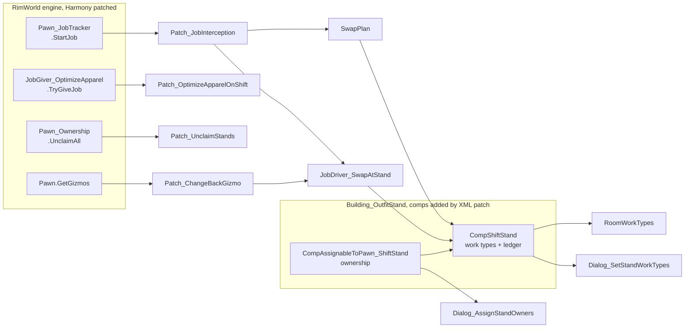

# Development

Build, debug and test loop. For why the mod is shaped the way it is, see
[DESIGN.md](DESIGN.md).

## Requirements

| | |
|---|---|
| .NET SDK | 8.0 or later. The project targets `net472`; `Microsoft.NETFramework.ReferenceAssemblies` supplies the targeting pack, so no Framework install is needed on macOS or Linux. |
| RimWorld | 1.6, with the Odyssey expansion. Optional for building, required for running and for engine navigation. |
| Harmony | The `brrainz.harmony` mod, at runtime only. Not vendored. |

## Build

```bash
dotnet build Source/ShiftChange/ShiftChange.csproj -c Release
```

Output goes straight to `Assemblies/`, which must contain exactly one file.
Any non-Debug build runs a `CleanDevArtifacts` target that deletes anything else
it finds there, including hot-reload leftovers.

### Three configurations

| Config | `SCENES` | ECR | Job |
|---|---|---|---|
| `Debug` | yes | yes | test runs — the default for observation and iteration |
| `Media` | yes | no | footage and screenshots: Release codegen, fixtures present |
| `Release` | no | no | shipping, and what the tests run against |

`SCENES` compiles in the demo and preview stage builders. **Release ships none
of them** — the stages are destructive enough that a player reaching one is a
colony-scale accident, and the reasoning is in
[DESIGN.md](DESIGN.md#development-tooling).

The tests are not a configuration but an assembly of their own,
`Source/ShiftChange.Tests`: .NET 10, for 1.7, against DevTools and the Release
dll, which grants it its internals (`InternalsVisibleTo`) and carries nothing
else of it. It builds into `Tests/Assemblies/`, which `LoadFolders.xml` loads
only while DevTools is active. Both ship, `Tests/` and `LoadFolders.xml` with
them: installing DevTools is a player's opt-in, and a player who has not loads
none of it. No CI job can build the tests without DevTools, so their dll is
committed and ships as committed, and it carries a fingerprint of the sources
it was built from: after a change under `Source/`, rebuild both dlls and commit
both, or `check-shipped-tests.py` fails the push. `run-harness.sh` builds both
dlls, leaves them in place and runs the tests; with a .NET 10 SDK, by hand:

```bash
dotnet build Source/ShiftChange/ShiftChange.csproj -c Release
dotnet build Source/ShiftChange.Tests/ShiftChange.Tests.csproj -c Release -p:DevToolsDll=<path>/DevTools.dll
```

Dev-only code in the mod's project is guarded **whole-file, never inline**, by
`SCENES` or `DEBUG`, so a Debug build and the build that ships differ in which
types are present rather than in shape. One file, `Dev/DebugTools_Fixtures.cs`,
is guarded `SCENES || HARNESS`: the tests' project compiles it too and defines
`HARNESS`, which the mod's never does. `check-invariants.py` enforces the rule,
and keeps harness files out of the mod's project; `check-shipped-dll.py`
enforces the outcome on the artifact.

`SCENES` on Debug is mandatory rather than a nicety: test runs happen on Debug,
and without it that build loses the fixtures they exist to drive.

`Media` is not redundant with Debug — `Patch_ModeBadge` draws the lab badge on
every Debug frame, which lands in the shot. Filming needs a badge-free, ECR-free
build that still has the stages.

**A `Media` build writes the same `Assemblies/ShiftChange.dll`**, so the
end-every-session-with-Release rule now covers filming sessions too. Committing
a Media dll would ship the fixtures; `devtools/check-shipped-dll.py` is what
catches it, in CI and before you push.

## Install

Symlink the repository into the game's `Mods/` directory, then enable it in the
in-game mod list along with Harmony. Enable **Development mode** in Options to
get the debug log and god tools.

Def changes require a full game restart. Do not use vanilla's `Hot reload Defs`
or the community equivalent; both corrupt live state on a large mod list. C#
changes are a different story, see [Hot reload](#hot-reload) below.

## Engine navigation

RimWorld publishes no API documentation, so go-to-definition into the engine is
the reference. `F12` on any engine type decompiles it in place.

Two things have to line up:

1. The editor is allowed to decompile. In VS Code that is one setting, and
   `.vscode/` is gitignored, so add it yourself:

   ```json
   { "dotnet.navigation.navigateToDecompiledSources": true }
   ```

2. The build references assemblies that actually contain IL.

| References | Source | `F12` shows |
|---|---|---|
| `Assembly-CSharp.dll` from a local install | game folder | real decompiled bodies |
| `Krafs.Rimworld.Ref` | NuGet | signatures only, empty stubs |

The project picks between them on **install presence, not build configuration**:
if a RimWorld install is found, every configuration uses the real DLLs; if not,
it falls back to Krafs.

Overrides:

| Goal | Flag |
|---|---|
| Non-standard install location | `RimWorldManaged=/path/to/Managed` (env var or `-p:`) |
| Reproduce the CI build exactly | `-p:DisableLocalGameRefs=true` |

CI has no game install, so it always compiles against Krafs, and the release job
rebuilds before packaging — so the GitHub release zip is always the Krafs build.
The Workshop dll is not: `publish-workshop.sh` stages a local Release build,
which carries whichever references the machine resolved — the real DLLs wherever
an install is present. Same public surface either way.

## Hot reload

Debug builds compile in Zetrith's EditCompileReload: a rebuild swaps changed
method bodies into the running game. Release references none of it.

```bash
dotnet build Source/ShiftChange/ShiftChange.csproj -c Debug
```

`[ShiftChange] hot reload applied` in the dev log is the heartbeat. ECR's own
messages are prefixed `[ShiftChange/ECR]`.

**UI and layout only.** Behaviour (jobs, ledger, scribing) is verified on a
clean Release restart, never in a swapped session.

| | Live | Media | Lab |
|---|---|---|---|
| Build | Release | Media | Debug |
| On-screen badge | none | none | cyan, turns orange at first reload |
| Gameplay interception | full | full | full until first reload, then disabled |
| Saving | freely | freely | never after a reload |
| Scene builders | absent | present | present |

A Debug build behaves identically to Release until the first reload. The first
reload forks the session into a lab: gameplay interception disables itself and
the save is no longer trustworthy. Open a disposable save before iterating.

Rules that are not obvious:

- **Never build Release during a hot session.** The sweep deletes the
  `.dll_orig` the watcher polls, killing reload until relaunch.
- **Structural edits need a restart**: instance fields, constructors, attribute
  changes, virtuals. New types and static fields do swap.
- A session is capped at 64 reloads. The 65th needs a restart.

### Language rules the rig imposes

ECR loads each reload as a new assembly and redirects methods into it, so every
member access from a swapped body is cross-assembly. Unity's Mono does not
implement `IgnoresAccessChecksTo`, so the only mechanism that works is
`InternalsVisibleTo`, granted to the numbered twins in `HotReloadVisibility.cs`.

| Rule | Failure if broken |
|---|---|
| `internal`, never `private` | `FieldAccessException` at the first swapped access |
| No auto-properties | backing field is always private, no syntax widens it |
| No protected base members | `MethodAccessException`; mirror the value as an internal const instead |

Within a single-assembly mod, `internal` and `private` are equivalent in
practice, so this costs nothing. CI enforces the first two.

## Runtime knobs

Dev mode → **Tweak values** → `ShiftChange`. These are `static`, not `const`,
specifically so they are tunable in play.

| Field | Default | Effect |
|---|---|---|
| `Enabled` | `true` | Master switch for all interception. A save load leaves it as set |
| `FaultLimit` | `3` | Throws in one game before interception takes itself out of service; loading a save or starting a game re-arms it |
| `Verbose` | `false` | Log every decision, not just swaps. Noisy. |
| `DressMidJob` | `true` | Mid-job catch-up when a stand frees up |
| `RetryCooldownTicks` | `600` | Minimum ticks before reconsidering a pawn whose swap could not start |
| `Patch_OutfitStandsPlusUseButton.Enabled` | `true` | Outfit Stands Plus' stand button reads our stand list; off hands it back its own walk over every building |

Mod settings carry three player-facing toggles: `poolUnassignedStands` (default
on), `keepColonistsDecent` and `medicalEmergenciesChangeFirst` (both default
off). Settings live in vanilla's config file, so uninstalling leaves no trace in
a save.

On a Debug or Media build: dev mode → **Shift Change** → **Dev tools…** →
**Build demo stage**, then click a cell: three roofed rooms (hospital,
laboratory, kitchen) with stocked stands, a self-starting kitchen bill and three
workers. **It clears a 13×16 footprint first** — every building, item and pawn
inside it is destroyed, so click somewhere empty. A Release build has no
**Shift Change** category at all.

## Testing

Behaviour is verified in game, on a clean Release restart. Two tools help.

**The demo stage** is the general fixture — a colony in one click, where a swap
can be watched end to end.

**The lifecycle harness** covers what the demo stage cannot: a hundred and six
cases that drive the engine's own entry points and assert where the ledger
landed.
What it covers, what it deliberately does not, the rules it follows and the four
engine traps it had to pay for are all in [TESTING.md](TESTING.md).

```bash
devtools/run-harness.sh              # a four-mod list — the iteration loop
devtools/run-harness.sh --full       # your own mod list — the release gate
devtools/run-harness.sh --alongside  # a second instance beside a live game
```

One command, no hands: builds Release with the harness, launches an isolated,
windowless 1.7 instance with a `HOME` of its own under `dist/testhome`, where
SmashPhil's DevTools runs every case as a test and quits the game, then prints
DevTools' report and exits non-zero on failure. DevTools runs on 1.7 only; on
1.6 the debug menu's run is the one there is. TESTING.md has the details.
Measured 2026-11-12, launch to process exit:

| Mod list | Wall clock |
|---|---|
| The four-mod list, and DevTools | ~30 s |
| `--full`, on a 233-entry list | ~220 s |

Those are one machine's numbers; `--full` scales with whatever list is active,
since almost all of it is RimWorld's own load time.

**The window does not need to be in front.** It used to: RimWorld's loading
screen advances off the main-thread update, so an instance whose window never
composited never progressed. The log stopped around line 49, in Unity's
preamble, before a single mod or def loaded, and the process sat near 0% CPU
forever. The cause was RimWorld's own `runInBackground` preference, which is
off in a fresh save-data folder, and the script now seeds it on. Measured
2026-09-11 with focus held on another app throughout: 3 of 3 seeded runs passed
with startup in 20 s, and 3 of 3 unseeded runs stalled; `--full` against the
real list then passed unfocused and unattended end to end. The engine lines
behind it are in the Prefs.xml block of `run-harness.sh`.

A stall is still cut short rather than waited out. A run that has not reached
RimWorld's own startup by `STARTUP_GRACE` (120 s), and whose log has then been
silent for `STALL_QUIET` (60 s), is stopped with a message saying so, instead of
the old behaviour — twenty minutes, then a message blaming the harness's launch
flag for something that happens before any mod is loaded. The grace is a floor, not a
deadline: a large list takes minutes to reach startup and writes to its log the
whole time. The startup probe greps for
`with mods:`, which is Verse's own output from both "Initializing new game with
mods:" and "Loading game from file … with mods:". **Do not "improve" that to
something that looks more precise.** The version banner is printed *before* the
stall, so it matches a hung run; and `Loaded assemblies` — which looks perfect
in a heavily modded Player.log — is printed by a mod, is absent on the four-mod
list, and reported a passing run as a stall the first time it was tried.

Before the fix, `--alongside` could not help: the instance already running
owned the foreground, and three consecutive attempts stalled. The same fix
covers it: the measurement held focus on another app for the whole run, which is
the worst case for an `--alongside` instance. Two things were tried and are not
the cause — a second instance existing (a clean run with nothing else open
stalled identically) and the test instance defaulting to fullscreen (seeding
windowed prefs did not fix it, though the script seeds them anyway, since
windowed and muted is right for a throwaway instance regardless).

Before investigating a "performance regression", check what else was running:
a live colony ticking alongside turns ~25 s into several minutes (the table
above). The harness itself executes in a single frame and cannot account for
minutes.

**The four-mod list is for iterating; `--full` is what a release is signed off
on.** This mod patches a vanilla building other mods also touch, so the small
list is precisely the environment in which a conflict cannot appear.

### Watching a case

The cases run only under DevTools. A failing case's transcript in `Test.log`
prints every assertion it made, pass or fail, and the pad's position; DevTools'
test explorer, in dev mode, lists each case with its sentence as the tooltip.

The debug menu keeps the scene builders, on a Debug or Media build.
**Search only filters the level you are looking at.** `DebugTabMenu.VisibleActions`
is `CurrentNode.children` and the filter tests each node's own label, so it does
not descend into submenus: typing `demo` at the top level matches nothing. Type `dev tools` to filter down to our entry — the category header still
renders above it, so a collision with another mod's identically-named entry is
still distinguishable — then open it and pick. This is the one ergonomic cost of
collapsing loose entries into one; it is paid on a dev build only, where the
submenu holds a handful of items and hunting is not the problem it was when
they sat loose among vanilla's hundreds.

A **Release** build has no debug-menu entry at all, and it is what the tests run
against: `run-harness.sh` builds it, then the tests, and runs the cases under
DevTools. That is the release gate, and the only one.

For a fast interactive session without the headless run,
`devtools/rimworld-profile.sh minimal` / `restore` swaps the live mod list. It
refuses while RimWorld is running: the game rewrites `ModsConfig.xml` on exit
and would undo the swap, or write the minimal list over the real one. It parks
your list once and restores it verbatim.

## CI

`.github/workflows/ci.yml`. Most of these checks exist because the codebase
broke that way once; the rest block a failure that would land silently.

| Check | Catches |
|---|---|
| `xmllint` well-formedness | malformed XML. Runs under `pipefail`, or a `find` that fails on a renamed directory drops a whole tree from validation with a green tick. |
| `devtools/check-invariants.py` | hot-reload hazards, translation keys in both directions, XML-to-C# type bindings, the `<Patch>` root walk, the Workshop preview size, Workshop comments over Steam's 1,000-character limit, and dates or line citations in source comments. Runs locally too — see [TESTING.md](TESTING.md). |
| `devtools/bbcode-preview.py` | an unclosed tag in the store description, which makes Steam render the rest of the page as literal text |
| Committed dll is uninstrumented, and alone | an instrumented Debug build reaching the mod's load path |
| `devtools/check-shipped-dll.py` | a `SCENES` build shipping the destructive scene builders, a harness file in the mod's project shipping the harness, and the opposite failure — over-gating that leaves the feature surface out. Run against the committed dll and again against the fresh Release build. |
| `devtools/check-shipped-tests.py` | a committed test dll built from other sources than the commit's, which would ship calls to members the mod no longer has; a `LoadFolders.xml` that loads `Tests/` for every player or drops the root for a version; the test dll anywhere but `Tests/Assemblies/`; a mod dll that references DevTools or grants the tests no internals. The release job runs it again on the zip's folder. |
| Media build | the filming config rotting between shoots, discovered on a shoot |
| Release build | compile errors against Krafs |

The lifecycle harness runs in a second workflow,
`.github/workflows/harness.yml`, on every push to any branch: the Release
build, then the tests against it and a dll of the DevTools the test machine
carries, then every case as a DevTools test in RimWorld 1.7 on a Linux machine with
Harmony, Core, DevTools and this mod (and the machine's own shim for running
without a window), once with every DLC and once with Odyssey alone.
The job passes on DevTools' exit code together with the `Result: Passed` line
it writes last in `Test.log`; its summary lists the failed and skipped tests
and the totals. The Odyssey run skips one test more than the other, the
recolor case, which needs Ideology. The workflow needs secrets, so unlike
`ci.yml` it does not run on pull requests: a fork's change is tested once its
branch is pushed here.

That is the minimal list only. `--full` on this machine, against a real mod
list, is still what a release is signed off on.

Tagging a commit `v*` additionally packages the mod folder and publishes a
GitHub release.

## Workshop upload

Deliberately manual, but **never through the dev symlink**. RimWorld's uploader
publishes the mod's folder verbatim: `Workshop.cs` hands `hook.Directory.FullName`
to `SteamUGC.SetItemContent`, `ModMetaData.GetWorkshopUploadDirectory()` returns
`RootDir` unfiltered, and `PrepareForWorkshopUpload()` has an empty body. Since
`Mods/ShiftChange` is a symlink to this repository, uploading through it ships
`Source/`, `media/`, `.github/` and the entire `.git` directory to subscribers.

```
devtools/publish-workshop.sh stage      # Release build + allowlist -> dist/
devtools/publish-workshop.sh install    # into Mods/, dev symlink removed
#   ... upload in game, then quit ...
devtools/publish-workshop.sh restore    # dev symlink back, item id recovered
```

Staged is ~1.1 MB against ~100 MB for the working tree — most of that is
`dist/testdata`, the harness's isolated save-data folder, which holds this
machine's own log and a copy of its mod list. `install` deletes the dev symlink
outright rather than parking it, because the game enumerates every directory
under `Mods/`, dot-prefixed or not, and two folders sharing `packageId` race
first-wins for which one the uploader publishes. `restore` recreates the link.

Two things the game does not upload, and one it does that matters:

- **The description comes from `About.xml`, not the BBCode.** `SetItemDescription`
  is called only on the create branch, so `media/steam-description.bbcode` has to
  be pasted into the Steam web editor by hand, and no later in-game update will
  push it. Get it right on day one; there is no second chance from inside the
  game.
- **Only `About/Preview.png` is uploaded.** `media/cards/*.png` need adding to the
  item's gallery in the browser, and the demo gif wants re-hosting on the item
  rather than hotlinked from imgur.
- **`About/PublishedFileId.txt` is written into the upload root** after a
  successful publish, and the create-vs-update branch keys off it. `restore`
  copies it back into the repo; commit it, or the next upload mints a duplicate
  listing instead of updating this one.

`publish-workshop.sh install` prints the browser checklist; follow it before
setting the item public.

### What goes in About.xml, and what does not

`About.xml`'s `<description>` is the in-game mod-list blurb — a small scrolling
panel answering "what does this do, and what does it need". It is not a store
page, and it is read by someone standing in the mod list, not browsing.

So it carries the things that change what a player does: the requirements, the
behaviour, the controls, and the apparel caveat (vanilla ships nothing worth
changing into, which is the first thing a new installer trips over).

It deliberately does **not** carry the meta: the AI-assistance disclosure, the
Ludeon trademark disclaimer, the source link as prose, or the gif. Those belong
on the surfaces where the mod is distributed — the Workshop page and the
README — which is where every one of them lives. Convention agrees: of 251
subscribed mods on this machine, **none** put the Ludeon disclaimer in
`About.xml`. The source link is in `About.xml` as `<url>`, which is the field
the game provides for exactly that and renders as a button.

## Logs

Dev log in game, or the full trace at:

```
~/Library/Logs/Ludeon Studios/RimWorld by Ludeon Studios/Player.log
```

Everything this mod writes is prefixed `[ShiftChange]`.

## File map



### `Source/ShiftChange/`

Folders by concern. Everything outside `Dev/` ships, and `check-invariants.py` holds that line: a file in `Dev/` must be dev-only, a dev-only file anywhere else fails, and so does a harness file, which belongs in the tests' project ([`Source/ShiftChange.Tests/`](#sourceshiftchangetests)). Every file keeps the one `ShiftChange` namespace, so a file moves between folders without touching a def, a save or a patch.

| File | Role |
|---|---|
| `ShiftChangeMod.cs` | Mod settings. |
| `ShiftChangeDefOf.cs` | Def references. |
| `SessionGuard.cs` | Clears session-scoped statics when the loaded game changes. Route any new static through it. |
| `HarmonyInit.cs` | Patch bootstrap. |

#### `Interception/`

`Patch_JobInterception` is one `partial` class across seven files, so `[HarmonyPatch]` stays on one declaration.

| File | Role |
|---|---|
| `Patch_JobInterception.cs` | Prefix on `StartJob`. The kill switch and fault latch, `TryInsertSwap` with its steps declared below it in the order they run (the gates, the vacuum gate, the return trip, the threat gate, then the work, sleep and recreation arms), and `Insert`, which defers the original job. |
| `Patch_JobInterception.Latch.cs` | The change-back latch, and the record of the job a pawn was just dressed for. |
| `Patch_JobInterception.CatchUp.cs` | The mid-job catch-up: a stand that comes free dresses the nearest colonist already doing what it serves. |
| `Patch_JobInterception.Deliveries.cs` | Deliveries and meal runs, judged by where they go: the site rule that keeps a uniform on, the area stand's delivery arm, and an errand queued ahead of served work. |
| `Patch_JobInterception.JobKinds.cs` | What kind of job this is: `Classify`, the one place a job's kind is decided, and the predicates it asks (eating, recreation, sleep, medical rest and the urgent patient, beds, and where recreation happens). |
| `Patch_JobInterception.StandSearch.cs` | Finding a stand: the trigger each one serves, and the nearest a pawn may use, passing over one whose outfit would strip vacuum protection the job needs. |
| `Patch_JobInterception.Places.cs` | Where a job happens and whether a catchment covers it: the shared resolver, `RoomBearing` for a solid target with no room of its own, `ReadPlace`, the one reading of a place a job names that the coverage checks and the vacuum walk share, and the coverage checks over every place a job names. |
| `Patch_JobInterception.Vacuum.cs` | The vacuum gate: on a vacuum map, whether every place a job names can be reached through air and through doors the colonist may pass (the air walk), asked by the stand search before a swap that would take protection away, and before a colonist goes on into vacuum in a uniform that protects less; whether the walk back to the stand stays in air; and the messages, at most one an hour per colonist, for an order into vacuum and for a colonist who cannot get back to their own clothes. |
| `JobPlace.cs` | Where a job happens: the cell its target names and, for a solid target, the cell beside it with a room. |
| `JobRoomTargets.cs` | Tables for jobs whose targets mislead: which end is the place, the ignored givers, deliveries, giver-less fishing, the ride-along, incidental and pass-through lists. |
| `Patch_ChangeBackGizmo.cs` | "Change back" command on a pawn in uniform, setting the latch per stand and trigger that the stand search honours; drafting drops it. |

#### `Swap/`

| File | Role |
|---|---|
| `JobDriver_SwapAtStand.cs` | Moves apparel, one direction at a time. Sets the forced flag on the way in, clears it on the way out. |
| `SwapPlan.cs` | The single answer to "what would this swap move". Every wearability predicate lives here. |
| `Patch_OptimizeApparelOnShift.cs` | Pauses the vanilla wardrobe optimizer while a pawn is checked out. |
| `Patch_ParkedKitOutscoresSpares.cs` | Stops a checked-out pawn re-arming from the colony's spare pile while their own kit sits parked in the stand. |

#### `Stand/`

`CompShiftStand` is one `partial` class across four files.

| File | Role |
|---|---|
| `CompShiftStand.cs` | The checkout ledger and the stand's lifecycle: who has its uniform out, spawn, despawn, reinstall and landing, and save and load. Ownership reads (`AssignedOwners`, `StillOurs`). Static registry of on-shift stands. |
| `CompShiftStand.Triggers.cs` | What the stand dresses for and its settings: work types from the room or ticked, the recreation and sleep triggers, automatic, custom and excluded, deposit only, full change and trade. The toggles keep the three triggers mutually exclusive. |
| `CompShiftStand.Catchment.cs` | What the stand serves: its room, a radius or an allowed area, and `Covers`, the one membership test. The Serves setting with its labels and ring, and the static registry of radius and area stands. |
| `CompShiftStand.Ui.cs` | What the player sees: the inspect pane, the gizmo, the "what this stand serves" labels, and the selection overlay. |
| `Alert_ShiftStandServesNothing.cs` | The alert for stands set to serve something that serve nothing: in the open, area gone, or outside their area. |
| `ServesMenuOption.cs` | A float-menu row that opens a section of the Serves menu with a gap. |
| `Dialog_SetStandWorkTypes.cs` | Per-stand work type picker. |
| `RoomWorkTypes.cs` | Room role to work type sets. Keyed by defName, silent-fail. |
| `RoomContentsWork.cs` | Work types a room earns from what stands in it, for rooms the engine gives no useful role. |
| `WorkTypeLabels.cs` | One place to turn a work type into the name the player sees. |
| `Patch_AllowRemovingToggle.cs` | Holds the stand's "Allow removing items" off while it is in service. |
| `Patch_DepositOnlyHauling.cs` | Keeps haulers out of a deposit-only stand, which takes in only what the sleep change parks on it. |
| `Patch_WithholdFromTrade.cs` | Keeps a shift stand's contents out of trade windows. |

#### `Ownership/`

| File | Role |
|---|---|
| `CompAssignableToPawn_ShiftStand.cs` | Ownership. Narrows candidates to pawns capable of the stand's work, swaps the vanilla assign window for ours, and keeps any other mod's owner list on the stand as a copy of ours (reconciling the two once for an older save). On a stand not used for shift changes, keeps a group from shift use until the player picks one colonist (`AssignSoleOwner`). |
| `Dialog_AssignStandOwners.cs` | The owner list. Replaces `Dialog_AssignBuildingOwner` for stands only — multi-select, a gender column and a gender filter, none of which the vanilla window exposes a seam for. On a stand not used for shift changes, Assign is a pick that replaces the list, and Assign all is not drawn. |
| `Patch_UnclaimStands.cs` | Releases stands when vanilla unclaims beds and thrones. Holds the reaper both it and the banish patch call. |
| `Patch_BanishStands.cs` | Calls the same reaper for banishment, the one colony exit vanilla routes past `UnclaimAll`. |

#### `Interop/`

| File | Role |
|---|---|
| `Interop_OutfitStandsPlus.cs` | Reflection bridge to Outfit Stands Plus. Silent-fail; absent mod means an inert file. |
| `Patch_OutfitStandsPlusUseButton.cs` | Transpiler that swaps the walk over every colony building, in Outfit Stands Plus' per-colonist stand button, for a per-map list of the colony's stands kept in the same order. Applied by hand from `HarmonyInit`, and only while their original IL still makes that call; otherwise it leaves the button alone and says why. Its case is in `ShiftChange.Tests/HarnessInterop.cs`. |
| `Patch_ForeignOwnerGizmos.cs` | Hides the other mod's Set owner control on every stand carrying ours, in both modes. Its list is a copy of ours, so an edit made through it would only be overwritten. |

#### `Dev/`

Each file here is guarded whole, by `SCENES`, `DEBUG` or `SCENES || HARNESS`, and none of it is in the mod's dll. `DebugTools_Fixtures.cs` ships only compiled into the tests'.

| File | Role |
|---|---|
| `DebugTools_Fixtures.cs` | Fixture primitives — make a thing, a pawn, a garment. `SCENES \|\| HARNESS`: the scene builders and the tests both build their fixtures from these, and the tests' project compiles this file in, defining `HARNESS`. |
| `DebugTools_Menu.cs` | `SCENES` only. The mod's entire debug-menu surface: one "Dev tools…" submenu. Absent in Release, so the category never renders. |
| `DebugTools_DemoStage.cs` | `SCENES` only. The demo stage. Test fixture and film set. Clears 13×16 before building. |
| `DebugTools_PreviewStage.cs` | `SCENES` only. The title-card stage, sized to crop to Workshop cards. Clears 32×10 before building. |
| `DebugTools_PoolStage.cs` | `SCENES` only. The pool fixture for the recreation arm, plus **Drain recreation** for forcing a joy roll. |
| `DebugTools_RecRoomStage.cs` | `SCENES` only. The black-tie games room: eight guests, eight stands, four joyKinds. Unlocks the research tree so the set can be redressed by hand. |
| `DebugTools_SleepStage.cs` | `SCENES` only. Bedtime in prestige cataphract, in the two shapes the gallery needs. |
| `DebugTools_ExportScene.cs` | `SCENES` only. Turns a hand-dressed room into the C# that rebuilds it. Pure inspection — reads the map, writes a file. |
| `DebugTools_Explain.cs` | `SCENES` only. Reports why a pawn is or is not taking recreation, one gate at a time. |
| `HotReloadVisibility.cs` | Debug only. `InternalsVisibleTo` grants for the reload twins. |
| `EcrWatchdog.cs` | Debug only. Polls for rebuilds, because Mono's `FileSystemWatcher` never fires on macOS. |
| `Patch_ModeBadge.cs` | Debug only. The on-screen live/lab badge. |

### `Source/ShiftChange.Tests/`

The tests' project (`ShiftChange.Tests.csproj`): .NET 10, for 1.7, built against
the Release dll and DevTools into `Tests/Assemblies/`, and loaded only with
DevTools. Its namespace is `ShiftChange.Tests`. It ships, in `Tests/`, as the
committed `Tests/Assemblies/ShiftChange.Tests.dll`.

| File | Role |
|---|---|
| `HarnessCases.cs` | Every case, one DevTools `[Test]` each, in run order, in one fixture per `CaseGroup` and the save/load fixture last. A test is named after its case's body, its `[TestDescription]` is the case's sentence, and its one line is a `Run` call. |
| `HarnessDevTools.cs` | `CaseGroup`, the fixtures' order; `HarnessFixture`, which every fixture derives from: the `Run` calls, which find the pad (once per map, `ReadyPad`) out of the camera's sight when a case needs one, stage the case and write its transcript to Test.log, and the log lines every fixture allows; `HarnessTestOrder`, which checks DevTools runs every fixture's tests once, in declaration order, at priorities of their own; and `HarnessLoadNote`. |
| `DebugTools_LifecycleHarness.cs` | The case machinery: `Case`, which stages, runs and tears down one case, its assertions (`Expect`, `ExpectKnownGap`, `Fail`), which signal DevTools as they go, the fixture types (a fixture's `Hold` keeps what the case arranged in place while the clock steps) and the pad finder. The cases' bodies, which drive real engine entry points, live in the files beside it — see [TESTING.md](TESTING.md). |
| `DebugTools_SaveRoundTrip.cs` | The four save/load cases. Separate file because they replace `Current.Game` and must run last. |
| `HarnessCatchments.cs` | The catchment cases, one `partial` class: `.Radius` for coverage and dressing in a ring, `.ReturnTrip`, `.BillProduct` for the haul that stores a finished bill's product, `.Deliveries`, `.Area`, `.AreaUi` for the alert and the Serves menu, and `.Latch`. The main file holds the cases true in every mode and the helpers several files share. |
| `HarnessVacuum.cs` | The vacuum cases, on the second map, which is a vacuum map: the ground they stand on, then a staged ship of a room, open floor and a second room, and the cases a review of the gate added (each dress path, doors, a stranded colonist, the cooldown, an urgent patient, a stand on another map). |
| `HarnessJobKinds.cs` | The job classifier as a table: every job shape the other cases build, and the kind and work type it must get. |
| `HarnessFixtureChecks.cs` | What every case takes for granted about its fixture: a colonist who needs no doctor, and open ground past the pad. Runs first. |
| `ClockFixture.cs` | The base of the tests on the game's clock: `Staged`, which sets a stand and a colonist up on the pad, runs a test's body and always tears down, puts Keep colonists decent back and writes the story; `Swap`, one change with the clock stepped until its driver ends. |
| `ChangingAtAStand.cs` | The swap on the game's clock: the forced-flag round trip, a stand that displaces nothing, the whole outfit, and a colonist who walks to the stand. Runs after the case fixtures. |
| `KeepingThemDecent.cs` | Keep colonists decent on the game's clock: the belt stand, the trousers pair for a man and a woman, the nudist, and the shipped default. |
| `GameClock.cs` | Steps the game's whole clock for a test, a frame at a time (`Run`) or within the caller's frame (`Step`, which `RunSwap` and `FinishBill` use), with the storyteller, random mental breaks and autosave held off, and puts them back. |
| `Story.cs` | A test's checks as lines in the game's words; the first failure fails the test with the lines so far, its own marked. |

### Content

| Path | Contents |
|---|---|
| `About/About.xml` | Metadata, dependencies. `Preview.png` is needed only for Workshop upload. |
| `Defs/JobDefs/` | `ShiftChange_SwapAtStand`, the swap job, both directions. |
| `Patches/` | Adds the two comps to the vanilla outfit stand def. |
| `Languages/English/Keyed/` | Gizmo and inspect strings. |
| `Assemblies/` | Build output. Exactly one dll. |
| `LoadFolders.xml` | The root for 1.6 and 1.7, and `Tests/` under 1.7 only while DevTools is active. Once the file exists it decides every folder the game loads, so the root entries are what load the mod at all. |
| `Tests/Assemblies/` | The tests' build output, `ShiftChange.Tests.dll`, committed. |

### `devtools/`

Not shipped — the release allowlist is `About Assemblies Defs Patches Languages
LoadFolders.xml Tests docs LICENSE README.md`.

| Script | Does |
|---|---|
| `run-harness.sh` | Runs the test suite as DevTools tests, headless in an isolated 1.7 instance. `--full`, `--alongside`, `--with`, `--with-after`. |
| `check-invariants.py` | The static checks CI runs. Run it before pushing. |
| `check-shipped-dll.py` | Asserts the built assembly ships no debug scenes and no harness, and still carries the feature surface. Run it before pushing; `publish-workshop.sh` runs it against the staged copy too. |
| `check-shipped-tests.py` | Asserts a mod folder ships the tests gated on DevTools, the root loaded for both versions, and a test dll built from the checkout's sources. `--fingerprint` prints the value the tests' build embeds. CI, `publish-workshop.sh` and `run-harness.sh` run it. |
| `rimworld-profile.sh` | Swaps the live mod list for a fast interactive session. |
| `publish-workshop.sh` | Stages a Workshop upload out of the working tree, and swaps it into `Mods/`. |
| `bbcode-preview.py` | Validates the store description and renders a local preview. |
| `footage.sh` | Screen capture for the demo gif. |
